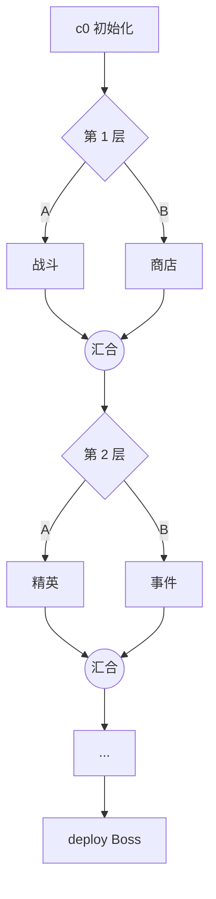

# 00 · 游戏概览

> 5 分钟版本。细节在 `01-设定` 和 `02-玩法`。

---

## 一句话

> **你带着一支会自己打架的 AI 小队，走在一棵可以回退、分叉、合并的树上。**

---

## 一局的样子



- **11 个节点**，6 层，每层二选一
- 一局 **15 分钟**
- 每完成一个节点，自动写进历史

---

## 你每局只有 6 个名额

| 动作 | 消耗 | 什么时候用 |
|---|---|---|
| **推进** | 免费 | 打完就往前走 |
| **revert 回退** | 1 | "这条路给的东西不对，我想重选" |
| **branch 分支** | 1 | "先去那边看看有什么" |
| **commit 提交** | 1 | 战斗中：冻结全场 + 给内存块上保险 |

> **6 个名额 = 6 次"我也许可以重来"。**

---

## 反悔要付利息

你按 `R` 退回上一个节点，会发生三件事：

1. **丢掉**回退点之后拿到的一切
2. **世界腐化 +10%**（敌人伤害永久提升，可叠加）
3. 那个被放弃的节点变成**灰色孤儿**——再走到那里，会遇到**你上次失败的残影**

> 你是在用"未来的难度"买"现在的选择"。

---

## 分支和合并

**分支（`B`）**：从当前节点开一条平行线。

- 两条线可以交替推进（`Tab` 切换）
- 支线战利品是**虚线暂存**，不能立刻用
- 随时可以放弃支线——**但暂存全丢，名额不退**

**合并**：两条线都到汇合点时自动发生。

| 收获类型 | 结算 |
|---|---|
| 普通（碎片 / 普通卡 / 内存格） | 全部保留 |
| 稀有（史诗卡 / 进阶碎片 / 羁绊碎片） | **同类只能选一个** |

> **分支买的是信息，不是收益。** 你去看过，才知道该选哪条。

---

## 战斗里你在做什么

| 你在做 | 系统在做 |
|---|---|
| 点地面，全队移动 | 角色自动普攻 |
| 点敌人，集火 | 引擎按形态出伤 |
| 拖一张卡到某个 AI 头上 | 算法生效 |
| 盯着内存块，别被打碎 | 敌人（尤其大型）在拆它 |

---

## 三层构筑

```
语言：C / Python / Rust ……        ← 底子（攻速、伤害、射程、克制）
引擎：Unity / Unreal / Godot / 自研 ← 武器（近战/远程 × 单体/范围）
算法卡：放进 5×5 内存块 = 牌库      ← 招式（CD、占格、效果）
```

**内存块会被打碎**：格子碎了，压在上面的卡就禁用，牌库缩水。

---

## 角色会成长

```
DeepQuest-R1
   ├── V4-Flash   （攻速 +30%，伤害 -15%）
   └── V4-Pro     （伤害 +30%，攻速 -25%）
          └── V4.1（继承分支 + 解锁专属算法）
```

---

## 队伍和羁绊

开局 1 个 AI，事件可招到 3 个。

| 羁绊 | 例子 | 效果 |
|---|---|---|
| 阵营（同公司 ×2） | 深索 ×2 | 全队算法 CD -10% |
| 关系（跨公司） | 深索 × 安索 | 伤害 +15%，但受伤 +10% |

---

## 结局

通关后打印你的提交图：

```
$ git log --graph --oneline

* e4f2a  deploy  ✓ v1.0
* 9c02b  第 6 层 · 精英
* 51aa4  第 4 层 · 商店   ← 这里 revert 过一次
| * 77e10 支线（已合并）
|/
* 2f019  初始化

revert 2 次 · 孤儿 2 个 · 腐化 +20%
```
