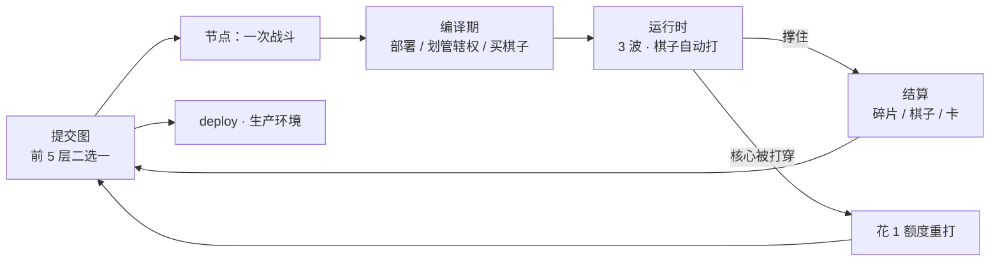

# 00 · 游戏概览

> 5 分钟版本。细节在 `01-设定` 和 `02-玩法`，棋子数值在 `03-图鉴`。

---

## 一句话

> **你被派进一台正在腐烂的机器，负责调度一支算法进程组。**
> **内存是有限的，而敌人在拆它。**

---

## 一局的样子



- **11 个节点**，6 层（前 5 层二选一，第 6 层 Boss）
- 一个节点 = **编译期（不限时）+ 运行时（60~90 秒）**
- 一局 **20 分钟左右**

---

## 棋盘：一块被围住的内存

```
                     ①
                  ╱     ╲
              ⑥           ②
              │    ◆    │
              ⑤           ③
                  ╲     ╱
                     ④

     ◆ 推理核心（1 格）
     ◇ 推理区（6 格，默认可部署）
     ▣ 六扇区（12 格，要花钱点亮）
     · 总线（18 格，敌人的走廊，6 个端口在这里）
```

| 环 | 格数 | 是什么 | 能不能部署 |
|---|---|---|---|
| **核** | 1 | 推理核心（你的命） | ✅ 只放 1 个棋子 |
| **环 1** | 6 | 推理区 | ✅ 默认已分配 |
| **环 2** | 12 | **六扇区**（各 2 格），**正对 6 个端口** | 💰 扩容点亮 |
| **环 3** | 18 | 总线 | ❌ 敌人的走廊 |

**初始内存 7 格**（核 + 环1），**上限 19 格**。

> **扇区 N 的正面，就是端口 N。**
> 所以「① 号口热」= 「扇区 ① 挨打」——**不用换算，是同一张图。**

> **扩容不是"变多"，是"点亮一扇门"。**
> 6 个门你只点得起 3~4 个——**剩下的方向，永远是盲区。**

---

## 一个节点怎么打

### 编译期（你想多久都行）

```
1. 看环境      ← 本节点是什么语言？接受 / 覆写 / 隔离
2. 摆棋子      ← 从交换区拖到内存格上
3. 划管辖权    ← 每个 AI 盖一块地，格子里的棋子吃它的加成
4. 买棋子      ← 商店刷新
5. 按 RUN ▶
```

### 运行时（你只能插手）

| 系统在做 | 你在做 |
|---|---|
| 棋子按自己的时间片攻击 | 拖指令卡到棋盘上 |
| **有些棋子自己会走**（贪心追击、DFS 冲刺） | 决定打哪张、什么时候打 |
| 敌人从端口涌进来 | 盯着核心血量和显存 |
| 每波随机触发运行时事件 | **每波 1 次热迁移**（2 算力 + 停手 2 秒） |
| 波间 3 秒间隙 | **按 `C` 决定还要不要打下去** |

**你不能自由挪棋子。** 程序已经在跑了——**搬一台正在跑的机器，要停机。**

> 所以挪棋子的方式只有两种：
> **有些算法本来就坐不住**（§5.5），或者 **你付 2 算力让它停 2 秒**（§4.6）。

---

## 你每波能做什么（指令卡）

算力 **每波回复 4 点**，卡 **耗 1~4 点**。

| 类型 | 怎么拖 | 例子 |
|---|---|---|
| **单体** | 拖到一个棋子上 | 编译、缓存、沙盒、向量化 |
| **区域** | 拖到一个区域上 | GC、刷新、广播、防火墙 |
| **全局** | 拖到棋盘空白处 | 中断、限流、死锁、分叉 |

> **卡不是用来赢的，是用来改节奏的。**
> 真正打赢的是棋子。你只是让它多打一下、少挨一下、晚死一秒。

---

## 四层构筑

```
算法棋子   冒泡 / DFS / 动态规划 / 回溯 ……   25 个，时间×空间决定一切
语言环境   C / Rust / Python / JS ……        8 种，改的是棋盘规则
指令卡     编译 / GC / 中断 / 分叉 ……        26 张，你的唯一实时干预
AI 管辖    DeepSeek / Claude / GPT ……        8 个，划地盘给加成，叠了会吵架
```

---

## 复杂度 = 节奏

**这是整份设计的地基。** 复杂度不是数值，是**它多久动一次**。

| 时间复杂度 | 出手间隔 | 单次强度 | 卡顿概率 |
|---|---|---|---|
| **O(1)** | 1.2 秒 | ×1.0 | 0% |
| **O(log n)** | 1.5 秒 | ×1.3 | 0% |
| **O(n)** | 1.9 秒 | ×1.8 | 0% |
| **O(n log n)** | 2.3 秒 | ×2.4 | 0% |
| **O(n²)** | 3.0 秒 | ×3.2 | 10% |
| **O(2ⁿ)** | 4.2 秒 | ×4.8 | 18% |

**空间复杂度** = 占几格：

| 空间 | 格数 | 形状 |
|---|---|---|
| O(1) / O(log n) | 1 | 单格 |
| O(n) | 2 | 相邻两格 |
| O(n log n) | 3 | 三角 |
| O(n²) | 4 | 菱形 |
| O(2ⁿ) | 6 | 蜂巢 |

> **低复杂度 = 快、稳、弱、省地方。**
> **高复杂度 = 慢、强、会卡、占一大块。**
>
> 一个 O(2ⁿ) 的棋子憋了四秒，抬手就被打断——**这就是"指数爆炸"的手感。**

---

## 你的 AI 是滤镜，不是角色

每个 AI 能管 **N 格内存**（= 它的上下文窗口）。盖上去，格子里的棋子吃加成。

| AI | 上下文 | 加成 | 缺陷 |
|---|---|---|---|
| **DeepSeek-V4** | 12 格 | 技能伤害 +20%，O(2ⁿ) 不再卡顿 | 启动慢 1 回合 |
| **Claude-4.5** | 16 格 | 免疫控制，每波免死一次 | 伤害 -10% |
| **GPT-5** | 10 格 | 全属性 +10%，抽卡 +1 | 算力消耗 +1 |
| **Qwen3** | 14 格 | 换语言时吃双语言加成 | 单体属性 -5% |
| **Gemini-3** | 20 格 | 显示敌人意图和弱点 | 显存 -2 |
| **Llama-4** | 8 格 | 部署省 1 格 | 属性随机 ±15% |
| **Mistral-Large** | 6 格 | 出手间隔 -20% | 只能管 6 格 |
| **Grok-4** | 10 格 | 暴击 +25% | 每波 10% 失控 |

### 共管：两个 AI 盖同一块地

- 加成**叠加**（第二个按 70% 算）
- 每波结束，重叠格 **+1 层对齐摩擦**（**不衰减**）
- **3 层**：25% 概率卡住
- **5 层**：暴走，攻击随机目标
- 清摩擦：只有 `刷新` 卡，或者把管辖权挪开

> **叠是最强的，也是唯一会让你自己人打自己人的。**

---

## 地图是提交图（3.2 的遗产，保留）

| 动作 | 花 | 效果 |
|---|---|---|
| **推进** | 免费 | 打完往前走，自动 commit |
| **提前 commit** | 免费 | 波间按 `C` 收工：拿部分碎片，**丢棋子**，留遗留进程 |
| **revert 回滚** | 1 额度 | 退回任意祖先，重选路；技术债 +1 |
| **branch 分支** | 1 额度 | 开平行线，两头跑 |
| **merge 合并** | 免费 | 稀有奖励二选一（conflict） |

**6 个额度**，revert / branch / 失败重打共用；推进、merge、提前 commit 不花额度。

### 提前 commit：唯一不花额度、但花机会的键

```
波 1 ──3秒── 波 2 ──3秒── 波 3
        ↑            ↑
      按 C         按 C
```

| 你在哪按 | 碎片 | 棋子 | 遗留进程 |
|---|---|---|---|
| 波 1 后 | 33% | ❌ | +10 |
| 波 2 后 | 66% | ❌ | +5 |
| 不按 | 100% | ✅ | 0 |

> **你发布的永远是个带 bug 的版本。** 那些 bug 会追着你到下一个节点。
>
> 所以 `C` 买的是"这局还能继续"，付的是"这局长不大"。

### 技术债不是"敌人变强"，是"编译变慢"

| 层数 | 后果 |
|---|---|
| 1–2 | 敌人 HP +10% |
| 3–4 | **所有棋子启动延迟 +0.5 秒** |
| 5 | 精英/Boss 必出 AI 型 |
| 6+ | Boss 多一个阶段 |

### 孤儿节点：你会遇到过去的自己

回退放弃的节点变灰。再走进去：

- 敌人 HP **+30%**
- 出现**残影（Ghost Commit）**：一支用你**当时阵容**的敌人小队

**打赢残影**：额外奖励 + **清 1 层技术债**。

> **"你战胜了上个版本的你。"**
> 这是全游戏唯一能还债的方式。

---

## 失败与耐久

| 层 | 规则 |
|---|---|
| **核心** | HP 100。被敌人摸到就掉。归零 = 本节点失败 |
| **节点失败** | 花 **1 额度**重打（棋子耐久不恢复） |
| **棋子** | 局内 HP 会死；**局外耐久 3 层**，死一次 -1 |
| **耐久归零** | 棋子消失。可花 60 碎片修 1 层 |
| **额度为 0 且节点失败** | 本局结束 |

> **你输的不是血量，是"重来的次数"。**

---

## Boss：生产环境

`deploy` 层的最终 Boss 是 **「生产环境」**——一个用你欠下的债长出来的巨型进程。

```
Boss HP   = 2400 + 技术债 × 120 + 损坏格数 × 40
```

| 阶段 | 名字 | 行为 |
|---|---|---|
| 1 | **灰度发布** | 召唤 2 个你阵容的镜像 |
| 2 | **全量发布** | 每 5 秒拆 1 格内存，Bug 无限涌 |
| 3 | **熔断** | 清空你所有 buff，30 秒 DPS 检查 |

> **你打得越烂，它越大。** 这就是技术债的最终形态。

---

## 结局

通关后打印你的提交图：

```
$ git log --graph --oneline

* e4f2a  deploy ✓ v1.0
* 9c02b  第6层 · 精英
* 51aa4  第5层 · 商店     ← 这里 revert 过一次
| * 77e10 支线（已合并）
|/
* 2f019  初始化

revert 2 次 · 技术债 +2 · 残影 1 个被击败
死过的棋子：DFS ×2 · 冒泡 ×1
```

---

## 一句话

> **棋子自己会打。**
> **你只做三件事：摆在哪、给谁管、什么时候插手。**
>
> **三件事都做对，你才配叫调度器。**
