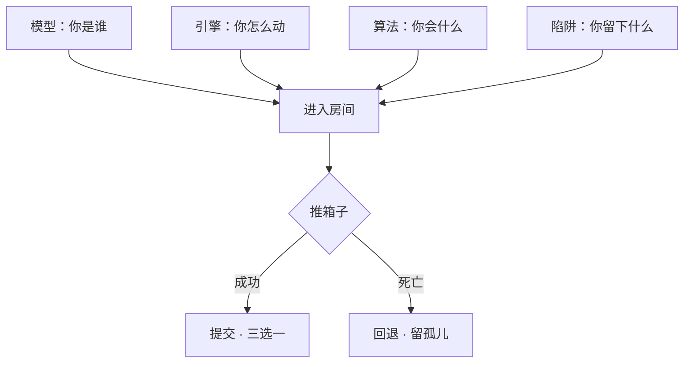

# 00 · 游戏概览

> 5 分钟版本。细节在 `01-设定` 和 `02-玩法`。

---

## 一句话

> **你打不过任何人。你只能改写历史——顺便把这块地推平。**

---

## 你身上有四层武装

这是 2.0 最大的变化：**同一个推箱子，有四种方式改变它。**

| 层 | 决定 | 举例 |
|---|---|---|
| **模型** | 你的被动 | DeepQuest-R1：每屏可撤销 1 步 |
| **引擎** | 你的动作形态 | Unreal：可以把块推出 2 格 |
| **算法** | 你的主动技能 | 二分查找：高亮最近的插槽，冷却 5 秒 |
| **陷阱** | 你能布置什么 | `pre-commit`：危害踩中后被冻 2 秒 |

**而房间本身还有两层规则**：

| 层 | 决定 | 举例 |
|---|---|---|
| **语言** | 这一屏的物理法则 | 这屏是 C：你可以穿块，但碰危害必死 |
| **世界层** | 这一章的主题 | 内核层：时间流速会突然变快 |

---

## 三个招牌机制（1.0 就有的）

### ① commit 是资源

每局 **8 次**。存一次档，少一次机会。

### ② 死亡会留下「孤儿」

半透明、不可消灭、会游荡。死得越多，地图越像雷区——而雷区是你铺的。

### ③ 最后的 Boss 是你

| 死了几次 | 面对什么 |
|---|---|
| 0~2 | 几秒就散的影子 |
| 3~5 | 同速追踪者，会走你上一格 |
| 6~9 | 一群孤儿，占半屏 |
| 10+ | **它开始念你写过的 commit message** |

---

## 一局 35 分钟

| 章 | 世界层 | 特殊规则 | 时长 |
|---|---|---|---|
| 1 | 硬件层 | 地板有电平开关 | 6 分 |
| 2 | 内核层 | 时间流速会突变 | 7 分 |
| 3 | 运行时层 | GC 定时清污染，也清你的陷阱 | 8 分 |
| 4 | 应用层 | 插槽会移动（需求变更） | 7 分 |
| 5 | 网络层 | 你的操作有 0.3 秒延迟 | 6 分 |
| 6 | 云端 | Boss | 5 分 |

---

## 和 1.0 的区别

| | 1.0 | 2.0 |
|---|---|---|
| 构筑 | 12 个补丁 | **模型 + 引擎 + 算法 + 陷阱**，四层 |
| 房间 | 一种规则 | **语言 × 世界层**，双重规则 |
| 章节 | 5 个目录 | **6 个世界层**，每层一条特殊规则 |
| 策略深度 | 中 | **高**（但上手仍然只需要会推箱子） |

---

## 一句话总结

> 这个游戏卖的不是"我赢了"，是"**我留下了什么**"。
>
> 通关时打印你的 git log，旁边写着："你在 `src/parser.py` 死过 3 次。"
