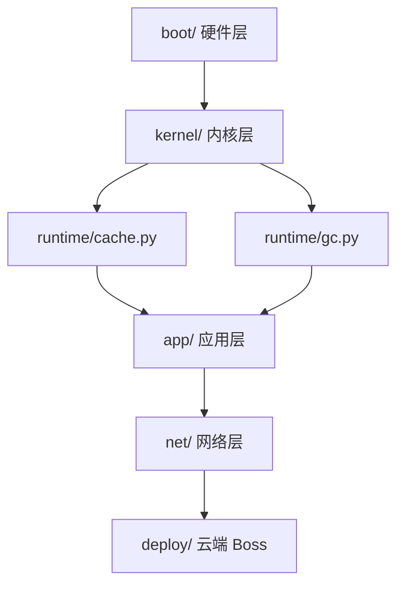

# 02 · 玩法设计

> 完整规则、数值、地图、MVP、技术架构。设定见 `01-世界观与设定`。

---

## 1. 核心循环

```
进入房间
   │
   ▼
推箱子（把 □ 推进 ▣）──── 危害在动，碰到就死
   │                          │
   │ 成功                     │ 死亡
   ▼                          ▼
三选一奖励                revert 到上个 commit
（算法/钩子/模块）            │
   │                          ▼
   ▼                     该房间危害 +1
commit（花 1 次名额）          │
   │                          ▼
   ▼                     留下一个孤儿
选择下一个节点                 │
   └──────────┬───────────────┘
              ▼
          回到房间
```

**一屏 30~90 秒，一局 35~45 分钟。**

---

## 2. 一屏（房间）里有什么

### 2.1 元素

| 符号 | 名字 | 规则 |
|---|---|---|
| `@` | 你（HEAD） | 上下左右移动，可推箱子 |
| `□` | 数据块 | 推到 `▣` 上就归位 |
| `▣` | 插槽 | 全部填满，这一屏就"干净" |
| `✖` | 危害 | 碰到你 = 死 |
| `◈` | 补丁 | 捡起来进暂存区 |
| `●` | commit 点 | 站上去可以提交 |
| `▓` | 污染格 | 走上去扣时间，不致死 |
| `⚡` | 电平开关 | 只在硬件层出现，踩了翻转相邻的墙 |
| `⌗` | 你布置的钩子 | 任何单位踩中都会触发 |

### 2.2 尺寸

- 网格 **7 × 7**，每格 64 像素
- 数据块 2~4 个，插槽 2~4 个，危害 1~3 个（随章节上升）

### 2.3 通关条件

**所有 `□` 都在 `▣` 上**（必须）。随时可以离开，但没填满就走 = 这一屏"脏"，下一屏危害 +1。

> 允许"打个脏补丁就走"，这是本作唯一的逃课方式，但代价明确。

---

## 3. 时间系统

### 3.1 基本节奏

| 规则 | 数值 |
|---|---|
| 危害移动间隔 | **2.0 秒 / 格** |
| 你的移动间隔 | 0.12 秒 |
| 暂停 | 按空格，**上限 3 秒** |
| 恢复缓冲 | 0.5 秒无敌（防止一恢复就死） |

**为什么暂停有上限**：无限暂停 = 无限思考 = 变回回合制。3 秒够"看一眼想一步"，不够"推演整局"。

### 3.2 各层对时间的影响

| 来源 | 影响 |
|---|---|
| 内核层 | 每 10 秒在 0.5x / 2x 之间切换 |
| 网络层 | 你的输入延迟 0.3 秒生效 |
| 汇编房间 | 暂停上限降到 1 秒 |
| 端侧阵营 | 暂停上限 +2 秒 |
| GML 的被动 | 危害移速 -20% |

---

## 4. 提交：唯一的存档，且要收费

### 4.1 规则

- 每局 **8 次**（阵营/模型会改）
- 必须站在 `●` 上才能提交
- **必须写一句话**（会进结局）
- 提交后：当前布局钉死；这一屏的危害数量**重置回初始值**

### 4.2 保存什么

| 保存 | 不保存 |
|---|---|
| 数据块位置 | — |
| 你的位置 | — |
| 这一屏的危害数（重置） | 孤儿（永远不消失） |
| 已收集的补丁 | 已布置的钩子 |

### 4.3 为什么存档要收费

> 免费存档 = 风险消失 = 死亡没有重量。
>
> 8 次之后，每一次提交都是真决定：**现在这个状态，值不值得钉死？**

---

## 5. 死亡与孤儿

### 5.1 判定

碰到危害 = **立刻死亡**。没有血条。

### 5.2 结算

```
1. 回到最近的 commit 点
2. 这一屏危害 +1（上限 6）
3. 没暂存的补丁丢失（暂存区 2 格保留）
4. 死亡位置生成一个「孤儿」
5. 总死亡次数 +1
```

### 5.3 孤儿

半透明的、**不可消灭**的 `@`。

| 属性 | 规则 |
|---|---|
| 移动 | 每 4 秒随机走一格，**不追你** |
| 伤害 | **不伤人**，只挡路 |
| 污染 | 走过的地方变 `▓` |
| 消灭 | 只能靠 `revert` 补丁（每章 1 次） |
| 清场 | 每章结束清空，但**计数保留** |

### 5.4 为什么不可消灭

> 它是你失败的**纪念品**，不是惩罚。
>
> 玩家会看到：**这条路是我自己堵死的。**

---

## 6. 分支

- 站在任意 commit 点按 **B**，消耗 **1 次 commit 名额**
- 房间布局相同，**危害位置重新随机**
- 两条线有**独立补丁池**
- 按 **Tab** 切换（1 秒硬直；Wanwen 无硬直）
- 最多 **2 条**，不能嵌套

**为什么要开分支**：有些房间随机出来的危害布局根本过不去。分支 = 换一次随机。

---

## 7. 合并

两条分支都到达同一扇门时，强制合并。

屏幕分成左右两栏，列出**冲突格**：

```
┌─────────────┬─────────────┐
│  主线        │  支线        │
├─────────────┼─────────────┤
│ A3  □ 已归位 │ A3  · 空     │  [留主线] [留支线]
│ B5  · 空     │ B5  ✖ 危害   │  [留主线] [留支线]
│ C1  ◈ 补丁   │ C1  ◈ 补丁   │  [只能选一个]
└─────────────┴─────────────┘
```

**逐格选择，全部解决才能继续。** 强行合并（Esc）会让仓库进入「冲突状态」：不能提交、不能离开。

---

## 8. 四层构筑

这是 2.0 的核心。四层各管一件事，互不重叠。

| 层 | 管什么 | 来源 | 数量 |
|---|---|---|---|
| **模型** | 你是谁（被动） | 开局选 | 1 |
| **引擎** | 你怎么动（动作形态） | 开局选 | 1 |
| **算法** | 你会什么（主动） | 房间奖励 | 最多 5 |
| **钩子** | 你留下什么（陷阱） | 房间奖励 | 最多 3 个 |

### 8.1 规则叠加顺序（重要）

出现冲突时，按这个优先级裁决：

```
① 世界上限（硬约束，比如"暂停最多 3 秒"）
② 世界层规则（这一章的主题）
③ 语言规则（这一屏的物理）
④ 阵营
⑤ 引擎
⑥ 模型被动
⑦ 算法 / 钩子
```

> 例：汇编房间说"暂停上限 1 秒"，端侧阵营说"+2 秒"。
> ② 优先于 ④ → **最终是 1 秒**。语言和世界的规则是"物理法则"，不能被装备覆盖。

### 8.2 奖励池（三选一）

| 类型 | 例子 | 概率 |
|---|---|---|
| **算法** | 二分查找 / BFS / 剪枝 | 45% |
| **钩子** | `pre-commit` / `pre-push` | 25% |
| **模块**（被动） | commit +1 / 视野 +2 / 移速 +10% | 30% |

**自研引擎**会额外看到一个"引擎升级"选项。

### 8.3 三个流派

| 流派 | 靠什么 | 适合 |
|---|---|---|
| **稳健流** | `bisect` + `+1 commit` + 视野模块 | 新手 |
| **控制流** | 钩子铺路 + `剪枝` + `拓扑排序` | 爱算的人 |
| **暴力流** | `DFS` + `快速排序` + 自研引擎 | 手快的人 |

---

## 9. 技术债与许可证

### 9.1 技术债（诅咒）

每章可以**主动**吃 1 个，换一个额外奖励：

| 技术债 | 收益 | 代价 |
|---|---|---|
| **硬编码** | +1 commit | 这一章的数据块**不能被推动**（只能靠算法） |
| **复制粘贴** | 立刻获得 2 个补丁 | 立刻 +1 孤儿 |
| **全局变量** | 移动 +30% | 每次死亡多留 1 个孤儿 |
| **没有测试** | 奖励多 1 个选项 | `blame` 失效（看不到危害轨迹） |
| **祖传代码** | commit +2 | 每屏开始时随机一个数据块位置错乱 |

### 9.2 许可证（遗物）

每章通关给 1 个：

| 许可证 | 效果 |
|---|---|
| **MIT** | 所有补丁冷却 -20% |
| **GPL** | 补丁效果 +30%，但**危害也能用一次** |
| **Apache** | 免疫一次死亡（本局 1 次） |
| **BSD** | 无副作用，但奖励少 1 个选项 |
| **商业许可** | commit +1，但每章多 1 层技术债 |

---

## 10. 地图：六层提交图

### 10.1 结构



- 每个节点 = 一屏
- 分叉 = 选路（**这就是肉鸽的路径选择**）
- 每层 3~4 个房间，共 **18~20 屏**

### 10.2 随机性

| 随机 | 范围 |
|---|---|
| 房间布局 | 箱子/插槽位置，每次进入重新生成 |
| 危害位置 | 每次进入、每次 revert 都重 roll |
| 语言 | 每房间随机分配（70% 呼应文件名） |
| 奖励 | 三选一，从池子抽 |
| 地图分叉 | 每章生成时随机 |

**同一个 seed 必须完全可复现**（调试与速通都需要）。

---

## 11. 一局流程

| 阶段 | 时长 | 内容 |
|---|---|---|
| 选人 | 1 分钟 | 模型 + 阵营 + 引擎 |
| 硬件层 | 6 分钟 | 3 房间，教推箱子/提交/死亡 |
| 内核层 | 7 分钟 | 3 房间，时间流速 |
| 运行时层 | 8 分钟 | 4 房间，GC 与钩子 |
| 应用层 | 7 分钟 | 3 房间，需求变更 |
| 网络层 | 6 分钟 | 3 房间，输入延迟 |
| 云端 | 5 分钟 | Boss |
| 结算 | 1 分钟 | 打印 git log |

**总计 35~45 分钟。**

---

## 12. Boss：你自己

所有孤儿在云端合体。

| 死亡次数 | 形态 | 行为 |
|---|---|---|
| 0~2 | 模糊影子 | 随机游荡，几秒消散 |
| 3~5 | 追踪者 | 和你同速，走你上一格 |
| 6~9 | 群 | 6~10 个孤儿，占半屏 |
| 10+ | **说话的东西** | 屏幕飘出你写过的 commit message |

### 怎么赢

**不是打死它。** 房间里有一个 `tag` 点，站上去 **3 秒**就打上 `v1.0`。

Boss 会阻挡、追逐、污染地面。

> **你不需要战胜过去，你只需要发布。**

---

## 13. 结局

```
$ git log --oneline

a3f21  v1.0 发布
9c02b  修复 parser 的越界读取
77e10  试着换了架构，失败，回滚
51aa4  加缓存，快了三倍
2f019  第一次提交

耗时 41:12  ·  死亡 7 次  ·  孤儿 7 个
你在 src/parser.py 死过 3 次。
```

**commit message 是玩家亲手写下的、唯一无法被 revert 的东西。**

---

## 14. 难度与平衡

| 章 | 危害数 | 危害间隔 | 数据块 | 新东西 |
|---|---|---|---|---|
| 1 硬件 | 1 | 2.5 秒 | 2 | 教学 |
| 2 内核 | 2 | 2.2 秒 | 3 | 时间流速 |
| 3 运行时 | 2 | 2.0 秒 | 3 | GC、钩子 |
| 4 应用 | 3 | 1.8 秒 | 3 | 需求变更 |
| 5 网络 | 3 | 1.8 秒 | 3 | 输入延迟 |
| 6 云端 | 3~6 | 1.6 秒 | 2 | Boss |

**死亡惩罚**：那一屏危害 +1（上限 6）。死 3 次就该考虑开分支了。

**平衡目标**：新手 3~5 次死亡通关，老手 0~2 次。

---

## 15. MVP：三期

2.0 的体量大约是 1.0 的 **1.8 倍**。**不要一次做完。**

### 第一期（4 周）：能玩

| 做 | 不做 |
|---|---|
| 推箱子 + 移动 + 碰撞 | 引擎、语言、钩子 |
| 危害 + 死亡 + revert | 分支、合并 |
| commit 名额 + 孤儿 | Boss、六层 |
| **算法 5 个** + 三选一 | 技术债、许可证 |
| 3 个房间串联 + 结局页 | 存档 |

**验收**：陌生人能打穿 3 屏，并且说得出"我刚才不该提交"。

### 第二期（3 周）：有味道

- 加 **引擎 4 种** + **语言 8 种**
- 加 **钩子 5 种**
- 算法扩到 13 个
- 加技术债与许可证

### 第三期（4 周）：完整

- 六层世界规则
- 分支与合并
- Boss 与结局演出

---

## 16. 技术架构

### 16.1 能复用旧代码

| 旧模块 | 怎么用 |
|---|---|
| `GameState` 模式 | 直接用，加 `history / orphans / room` |
| `intents.py` | 换成 `Move / Commit / Branch / Merge / UseAlgorithm / PlaceHook` |
| 事件系统 | 直接用，UI 靠它播动画 |
| JSON 数据驱动 | 直接用，房间/算法/钩子都进 JSON |
| `tools/simulate.py` | 改成"自动通关 400 张随机图" |
| `tests/` | 保留思路 |

### 16.2 要新写

| 模块 | 职责 |
|---|---|
| `core/room.py` | 7×7 网格、推箱子、碰撞 |
| `core/hazard.py` | 危害的 tick 移动、污染 |
| `core/history.py` | 快照、commit、revert |
| `core/orphan.py` | 孤儿的生成与游荡 |
| `core/algorithm.py` | 13 个算法的效果与冷却 |
| `core/hook.py` | 5 种钩子的布置与触发 |
| `core/graph.py` | 提交图、分支、合并 |
| `core/rules_stack.py` | 七层规则叠加（见 8.1） |

### 16.3 规则叠加的实现

```python
# 所有修正都走"规则栈"，不要到处写 if
def effective(state, key, base):
    value = base
    for layer in state.rule_layers():   # 按优先级从高到低
        value = layer.modify(key, value)
    return value

# 例：暂停时长
pause_cap = effective(state, "pause_cap", 3.0)
```

> **不要在每个函数里写 `if 房间是汇编: pause = 1`。**
> 规则叠加做成数据驱动的栈，加一层规则就加一个 modifier，不改旧代码。

### 16.4 三条红线

1. **core 不许 import pygame** —— 要能命令行跑 1000 次
2. **随机必须走 `state.rng`** —— 同 seed 可复现
3. **不许出现 "damage" 这个词** —— 一旦出现，说明设计跑偏了

---

## 17. 风险

| 风险 | 表现 | 对策 |
|---|---|---|
| **系统太多** | 四层构筑 + 双层房间规则 = 玩家看晕 | 第 1 章只教推箱子，第 2 章才给第一个算法 |
| **钩子变万能** | 铺满就赢 | 钩子会被 GC 清，且能困住自己 |
| **引擎改变关卡设计** | 推 2 格的引擎让所有关卡失效 | 关卡生成时按引擎参数生成，不要写死 |
| **六层做不完** | 每层都要新规则 | 第三期再做，前两期只做 2 层 |
| **实时太难** | 新手劝退 | 第 1 章危害 2.5 秒一步，很慢 |

---

## 18. 需要拍板

| # | 问题 | 建议 |
|---|---|---|
| 1 | 先做 1.0 还是直接 2.0？ | **先做 1.0**。2.0 的体量对五人是两个月 |
| 2 | 四层构筑会不会太多？ | 会。**第一期只做"模型 + 算法"两层** |
| 3 | 引擎要不要能改？ | 不能。开局选定，整局不变（否则关卡没法设计） |
| 4 | 语言要不要做成玩家装备？ | **不要**。它是房间属性，这是他最"程序员"的地方 |
