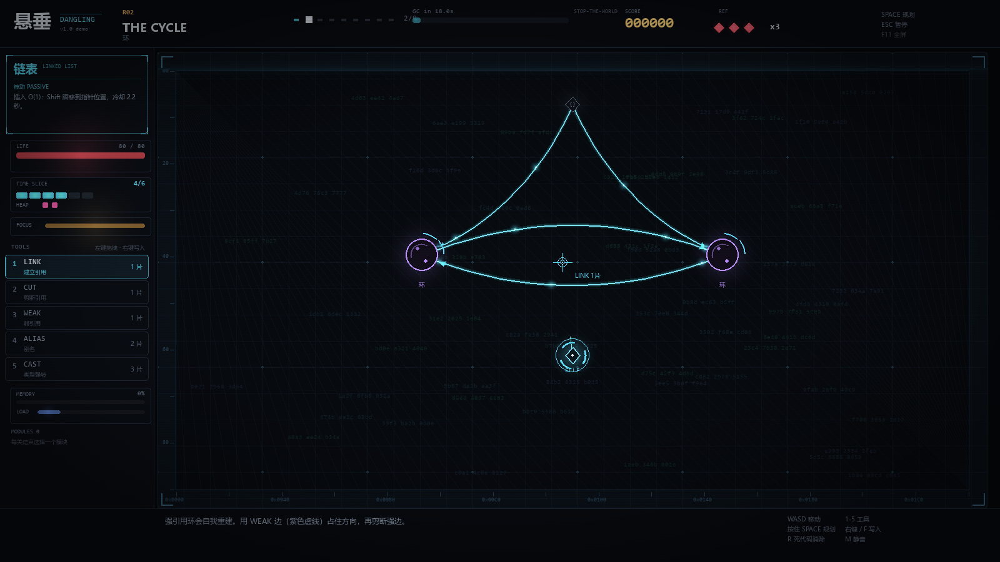

# 悬垂 DANGLING

> 一款胜利条件是**改变引用图拓扑**、而非清零血量的即时战术 Roguelike。
> pygame 完整演示版 · 1600×900 全屏 · 9 个固定房间 + Boss

你操作的从来不是物体，是引用。



---

## 运行

```bat
双击  开始游戏.bat
或    python run.py
```

需要 Python 3.9+ 与 `pygame-ce`（或 `pygame`）：

```bat
pip install pygame-ce
```

常用参数：

| 命令 | 作用 |
|---|---|
| `python run.py` | 全屏启动 |
| `python run.py --windowed` | 窗口模式 |
| `python run.py --body hash` | 指定身体（list / array / hash / tree） |
| `python run.py --room 7` | 直接从第 8 关开始 |
| `python run.py --shots` | 无头渲染各界面截图到 preview/ |

游戏内：`F11` 切换全屏，`M` 静音，`ESC` 暂停。

---

## 操作

| 输入 | 作用 |
|---|---|
| `WASD` / 方向键 | 移动（你是图里一个节点，也只是一个节点） |
| `1` `2` `3` `4` `5` | 切换工具：LINK / CUT / WEAK / ALIAS / CAST |
| 左键拖拽 | 用当前工具作用（LINK/WEAK/ALIAS 拖 A→B） |
| 左键划过引用线 | CUT：剪断划到的所有边 |
| 右键 / `F` | WRITE：对附近敌人造成少量直接伤害（会留下内存泄漏） |
| 按住 `SPACE` | 规划：冻结世界，专注条耗尽为止 |
| `R` | 死代码消除（需要该模块） |
| `Shift` | 链表身体：瞬移 |

---

## 核心规则

**世界只有两类东西：对象，和指向对象的引用。**

- `refcount` = 一个节点**入边中 STRONG 的数量**。
- **引用归零 → 立刻被 GC 擦除**，无伤害、无动画、直接消失。这是最高效的击杀。
- 剪掉「枢纽节点」的入边，挂在上面的整片子节点会级联消失。
- 每条提示都在屏幕底部；关底可以在三种模块里选一个重构构筑。

### 五个动词

| 工具 | 语义 | 代价 |
|---|---|---|
| `LINK` | 建立强引用（refcount++）。从 SELF 出发 = 持有目标，它停火，但你受伤它分摊 40% | 1 时间片 |
| `UNLINK` | 剪断引用（refcount--） | 1 时间片 |
| `WEAK` | 弱引用：不计入 refcount。**破环**、**保留悬垂指针** | 1 时间片 |
| `ALIAS` | 别名：两对象共享血池，伤害/死亡同步 | 2 时间片 + 1 堆 |
| `CAST` | 强转：`NULL` 眩晕 3s 并让出边悬空；`int` 截断行为并造成范围伤害 | 3 时间片 |

### 六种机制

1. **GC 擦除 / 级联**：先孤立，再回收。剪断入边比打血条快一个数量级。
2. **GC 停顿**：每 ~18 秒，全世界冻结 2.2 秒，期间**拓扑操作免费**。计时条永远可预判。
3. **UAF 劫持**：用 WEAK 咬住一个即将被回收的槽位，槽位重新分配时，新对象被你接管。
4. **内存泄漏**：直接伤害击杀会留下泄漏物——不可选中、不可回收，但**挡子弹**，也是逼近 OOM 的倒计时。
5. **off-by-one**：走到竞技场边界之外那一格，可以读写关卡元数据（刷新表 / 引用计数表 / Boss 血条）。
6. **别名共享**：把炸弹和硬壳别名，一次引爆等于击杀；把自己和 Boss 别名，共享血条。

### 四种身体（数据结构）

| 身体 | 优势 | 灾难 |
|---|---|---|
| 链表 | 极快、瞬移 | 断链：定期剪断你的一条引用 |
| 数组 | 高血、批量剪全部入边 | 扩容：定期把你钉在原地 |
| 哈希表 | 剪线有几率连锁、堆多 | rehash：负载因子 0.75 时全场洗牌 |
| 树／图 | 范围失效：一次剪掉整棵子树 | 退化：每用一次变慢 |

---

## 九个房间

| # | 房间 | 教学 |
|---|---|---|
| 1 | HELLO, WORLD | 剪断入边 → GC 擦除 |
| 2 | THE CYCLE | 强引用环，必须用 WEAK 破环 |
| 3 | ALLOCATOR | 父节点死亡 → 整片子节点级联 |
| 4 | USE AFTER FREE | 悬垂指针 + 槽位重分配 = UAF 劫持 |
| 5 | MEMORY LEAK | 泄漏是最好的掩体 |
| 6 | OFF BY ONE | 边界外那一格是元数据 |
| 7 | ALIASING | 别名 + 炸弹 = 一次引爆 |
| 8 | SENTINEL PRIME | 先切枢纽，再收尾 |
| 9 | GC BOSS | 两阶段：三根塔架 → 核心重构为强引用环 |

---

## 代码结构

```
run.py              启动入口
dangle/
  const.py          布局常量、调色板、字体、光晕
  fx.py             震屏 / 闪白 / 顿帧 / 粒子 / 故障
  model.py          Node / Edge / Graph（refcount 模型）
  content.py        身体、模块、九个房间的数据表
  battle.py         战斗核心：工具、GC 级联、别名、UAF、AI、Boss
  render.py         战场渲染与 HUD
  screens.py        标题 / 选身体 / 重构 / 暂停 / 结局
  app.py            状态机与主循环
  audio.py          程序化音效（无外部素材）
tools/
  sim_test.py       核心机制无头测试（49 项）
  flow_test.py      流程集成测试（19 项）
  input_test.py     鼠标拖拽/剪线/强转菜单输入测试（13 项）
  bot_test.py       自动解题机器人，验证 9 关 + Boss 可通关
  perf_test.py      性能测试（约 4~5 ms/帧）
  window_test.py    真实窗口冒烟测试
  fullscreen_test.py 全屏冒烟测试
preview/            各界面截图（--shots 生成）
```

全部素材都是代码画出来的：没有图片、没有音频文件，字体走系统微软雅黑 + Consolas。
音效是启动时用正弦/锯齿/噪声合成的。
