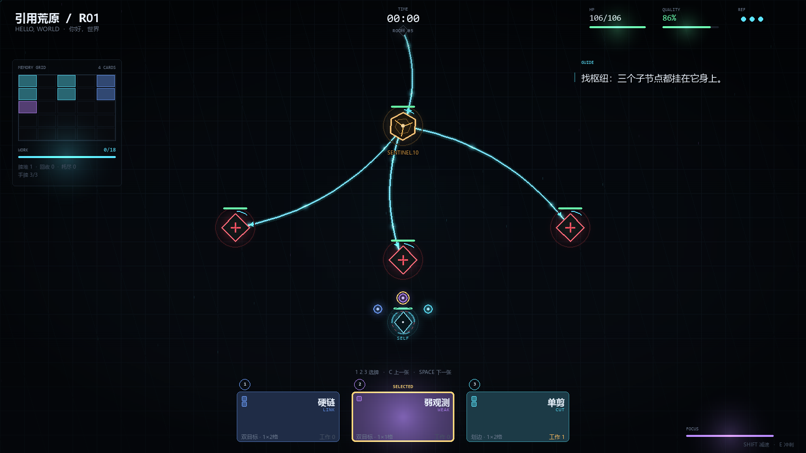

# 悬垂：内存远征 / DANGLING RUN

**单人实时卡牌肉鸽 · pygame-ce · 1600×900 · 全程序化美术与音频**

[](https://github.com/Illusion-Countdown/RE-AI/actions/workflows/ci.yml)


把卡组塞进网格，留白就是工作内存。剪断引用，让整片对象归零。



---

## 项目是什么

一个**算法题材的单人实时卡牌肉鸽原型**：

- 用 `refcount` 和引用图驱动战斗
- 卡牌是网格里的实体，占格数就是内存占用
- 画质是资源，剪线、放牌、坏死都会让画面逐步“渲染崩溃”
- 固定 5 区 18 战 + 5 Boss，带教程、商店、整备、卖卡和 `++` 升级

当前阶段：**可玩 Alpha（v0.5.1-alpha）**。目标不是做完整商业游戏，而是把一个“引用图 + 卡牌 + 资源”的核心循环打磨到可玩、可扩展、可协作。

## 项目不是什么

- ❌ 不做联机 / 匹配 / 服务器
- ❌ 不做移动端 / Web 端 / 多平台商店
- ❌ 不引入外部商业素材
- ❌ 不追求 3A 演出或写实美术
- ❌ 不在当前阶段做 Mod 系统、创意工坊、账号系统

如果未来范围变化，会先更新 `ROADMAP.md` 和本 README。

---

## 现在能玩什么

| 类别 | 内容 |
|---|---:|
| 教程 | 4 节 |
| 正式关卡 | 5 区 18 战 |
| Boss | 5 个 Boss 房，3 种 Boss |
| 卡牌 | 16 张，支持 `++` |
| 模块 | 14 个 |
| 普通敌人 | 12 种 |
| Boss 规则 | 5 条 |
| 身体 | 3 种 |
| 程序化音效 | 27 个 |

完整内容表见 [`docs/CONTENT.md`](docs/CONTENT.md)。

---

## 快速开始

### 环境

- Windows 10/11（主要测试平台）
- Python 3.10+
- pygame-ce

### 安装与运行

```bat
python -m pip install -r requirements.txt
python run.py --windowed
```

或双击 `gameStart.bat`。

全屏运行：

```bat
python run.py
```

无头生成截图：

```bat
python run.py --shots
```

如果音频设备异常：

- `F2`：播放测试和弦
- `F3`：循环切换 Windows 输出设备

---

## 操作

| 输入 | 作用 |
|---|---|
| WASD / 方向键 | 移动 |
| E | 朝鼠标方向冲刺 |
| SHIFT | 时间减速，消耗 FOCUS |
| 1 / 2 / 3 | 选择对应手牌 |
| C | 切换到上一张手牌 |
| SPACE | 切换到下一张手牌 |
| 左键拖拽 | 按住手牌拖到边/对象/区域，松手使用；整备界面按住卡拖进网格 |
| 鼠标左键划线 | CUT：按住划过引用线，松手剪断 |
| 右键 | WRITE：朝鼠标方向攻击，不耗卡 |
| G / R / T | 免费 GC / 坏死引爆 / 死代码消除（需对应规则或模块） |
| ESC | 暂停 |

---

## 核心循环

```text
装卡（网格） → 抽整个卡组 → 用卡改图 → 引用归零 / GC 级联
      ↑                                              ↓
  奖励后整备 / 商店 ← 三选一奖励 ← 清房结算 ← 画质 / 坏死格
```

关键规则：

- `refcount` 只数 STRONG 入边；归零立刻 GC。
- WEAK 不计 refcount，但目标受伤 +35%、对玩家伤害 -35%。
- LINK 敌人 = 争夺：敌人停火，替你分摊 15%/条，上限 45%。
- CUT 按住左键划路径，基础剪第 1 条边，`++` 剪前 2 条；消耗 1 工作内存。
- 手牌固定 3 张：初始抽 3 张，默认选中中间一张并进入瞄准；每用 1 张抽 1 张，牌堆空后不再抽牌。
- 每张卡每房最多回收一次：第一次使用后随机放回牌堆，第二次使用后本房耗尽；下一房重新计算。
- 画质 = 资源：负载、工作内存、坏死格都会压低画质。
- 最低画质只保留约 11% 世界像素，HUD 保持清晰。
- 奖励后与 Boss 安全屋都能整备、进商店；同名基础卡互拖免费 `++`。
- 碎片：普通房 +1、Boss +3、完美 +2；修格 2 碎片/格；不要的卡拖到 SELL 卖。

---

## 代码结构

```text
run.py
memory_run/
  core/          Node / Edge / Graph / Card / Grid / Hand
  content/       身体、AI 娘、模块、Boss 规则、卡牌、房间、奖励池
  run/           远征状态、经济、商店
  battle/        core / input / actions / gc / player / enemies
  ui/            app / render_* / screens / deckui / fx
  platform/      程序化音频
tools/           架构/机制/房间/流程/教程/界面/拖拽/音频回归
```

文档总索引：

- [`docs/README.md`](docs/README.md)

代码结构、文件所有权、分工与接口：

- [`docs/DEVELOPMENT.md`](docs/DEVELOPMENT.md)

新增功能如何提需求：

- [`docs/FEATURE_REQUESTS.md`](docs/FEATURE_REQUESTS.md)

---

## 测试

```bash
python tools/run_all.py
```

包含：

- 分层依赖检查
- 机制测试
- 18 关清场
- 教程
- 完整流程
- 全界面渲染
- 拖拽
- 音频

单独运行示例：

```bash
python tools/mechanics_test.py
python tools/rooms_test.py
python tools/screens_test.py
```

---

## 参与贡献

1. 先看 [`CONTRIBUTING.md`](CONTRIBUTING.md) 和 [`ROADMAP.md`](ROADMAP.md)。
2. 新功能先开 Issue，不要直接写大 PR。
3. Bug 请附 `crash.log`、复现步骤、系统和 Python/pygame 版本。
4. PR 必须说明改了什么、怎么测、影响哪些文件。
5. 遵守 [`CODE_OF_CONDUCT.md`](CODE_OF_CONDUCT.md)。

安全漏洞请走私密渠道，见 [`SECURITY.md`](SECURITY.md)。

---

## 路线图

当前与下一阶段目标见 [`ROADMAP.md`](ROADMAP.md)。

近期重点：

- 补齐内容校验、种子回归、性能基线
- 继续拆 `screens` / `runstate`，降低多人冲突
- 新区域、新卡、新敌人

---

## 许可证

代码以 **MIT License** 发布，见 [`LICENSE`](LICENSE)。

项目不使用外部商业图片/音频；所有美术与音效由代码生成。第三方库的许可证见依赖本身。

---

## 致谢

- `DANGLING`：引用图、几何怪物、标题/结局图、模块符印的表现语言
- `asymptote`：程序化合成音频层与慢放思路
- pygame-ce 与所有贡献者
