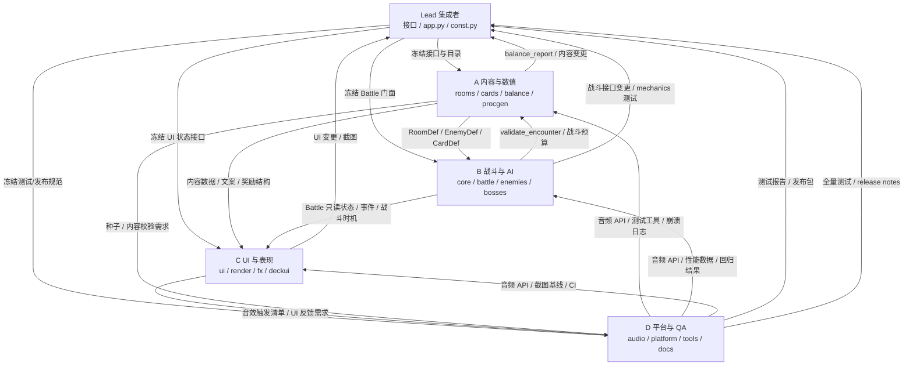

# 《内存远征》单人模式 · 四人协作与文件拆分方案

> 适用范围：`D:\game cs-based\待选游戏\MEMORY_RUN`
> 目标：只做单人模式，不写联机；在现有可玩版本上重构、扩内容、补程序化世界生成。
> 原则：**不重写玩法，只重写文件边界。** 先让四个人能并行，再谈加内容。

---

## 0. 结论先行

### 该重写还是重构

**重构 + 丰富，不重写。**

保留现有：

- 引用图 / refcount / GC 级联
- 卡牌网格 / 手牌 / 画质 / 坏死格
- 18 关内容、5 Boss、4 教程
- 商店、整备、卖卡、碎片经济
- DANGLING 几何美术、程序化音频
- 现有无头测试

重构掉：

- `battle.py` 单体
- `render.py` 单体
- `app.py` 单体
- 内容数据与战斗逻辑混在一起
- UI 直接读/改战斗内部状态

### 最多拆几个“互不影响”的部分

- **当前代码不动结构**：最多 **4 个低冲突工位**。
- **完成本方案的目录拆分后**：可以做到 **6–7 个相对独立工作流**。
- 再往上拆，接口和合并成本会大于收益。

### 程序化世界生成该给谁

**应该有人负责，但不是独立第 5 人，先交给“内容与数值”负责人 A。**

原因：

- 程序化世界生成本质是**内容系统**：房间图、敌人编队、难度预算、奖励节奏。
- 它需要战斗负责人 B 提供“合法遭遇”的校验接口。
- 它不需要 UI 负责人 C 或平台负责人 D 主导。
- 如果世界生成后来膨胀成独立系统（生物群系、图语法、导演 AI），再从 A 拆出第 5 个“Worldgen”角色。

**分工结论：**

- A：拥有 `content/procgen/`，负责生成器、模板、种子、内容校验。
- B：拥有 `validate_encounter()` / `simulate_room()`，负责“这个房间是否可打、是否有解”。
- 你：冻结 `RunPlan` / `RoomPlan` 接口，负责最终集成。
- C：只负责把生成结果显示得好看，不决定生成规则。
- D：负责种子回归、批量模拟、性能与 CI。

---

## 1. 当前基线

当前 `MEMORY_RUN` 已经可玩：

| 项 | 当前 |
|---|---|
| 正式关卡 | 5 区 18 战 + 5 Boss |
| 教程 | 4 节：CUT / WEAK / LINK / CAST |
| 卡牌 | 16 张，支持 ++ |
| 模块 | 14 个 |
| 经济 | 碎片、商店、卖卡、修格 |
| 画质 | 4 档，最低约 11% 世界像素 |
| 测试 | mechanics / flow / rooms / tutorial / screens / drag |
| 入口 | `run.py` |

当前主要大文件：

```text
memory_run/app.py       ~700 行
memory_run/battle.py    ~1800 行
memory_run/render.py    ~1100 行
memory_run/content.py   ~400 行
memory_run/cards.py     ~490 行
memory_run/runstate.py  ~350 行
memory_run/screens.py   ~550 行
memory_run/deckui.py    ~450 行
```

这些文件是“可玩原型”的合理产物，但不适合四个人同时改。

---

## 2. 协作原则

1. **一个人一个目录领地**：不要两个人同时改同一个大文件。
2. **接口先冻结，功能后并行**：先定 `Battle`、`RunState`、`Content`、`FX` 的公共接口。
3. **内容只加数据，不写战斗分支**：新房间、新卡、新敌人优先走数据表。
4. **UI 只读状态**：渲染层不能反向修改 `Battle` / `RunState`。
5. **`app.py` 只由集成者改**：它是所有状态的汇合点。
6. **每次合并必须跑测试**：不能“我这边能跑”。
7. **小 PR**：一个 PR 只做一件事，最好 < 400 行 diff。
8. **先重构后加内容**：目录没拆开前，不要四个人同时加系统。

---

## 3. 角色分工

### 你（Lead / 集成者）

负责：

- `run.py`
- `memory_run/app.py`（最终形态可为 `ui/app.py`）
- `const.py`
- 公共接口定义
- 合并顺序、代码评审、版本 tag
- 跨模块争议裁决
- 最终验收

不负责：

- 不替队友写完整模块
- 不在队友分支上直接改代码

### 队友 A：内容与数值

负责：

- 房间、区域、敌人编队
- 卡牌数据、模块数据、Boss 规则
- 商店价格、奖励池、碎片产出
- 难度曲线、危险度、敌人 HP/伤害预算
- **程序化世界生成**
- 内容校验器、种子回归

主要目录：

```text
memory_run/content/
memory_run/content/procgen/
memory_run/balance.py
```

交付标准：

- 不改 `battle/actions.py` 就能加一个房间、一张卡、一个模块。
- 新内容通过 `validate_content.py`。
- 给定种子能复现同一套关卡。

### 队友 B：战斗与 AI

负责：

- 引用图规则、GC、级联
- 卡牌实际效果
- 敌人行为、Boss 阶段、增援/编队
- 伤害、护盾、控制、投射物
- 战斗合法性校验接口

主要目录：

```text
memory_run/core/model.py
memory_run/core/graph.py
memory_run/battle/
```

交付标准：

- 新机制通过无头测试。
- 不依赖 UI 就能跑完一整关。
- 提供 `validate_encounter()` 给世界生成使用。

### 队友 C：UI、整备与美术表现

负责：

- 战场绘制、HUD、卡面
- 标题/奖励/商店/结算/教程界面
- 整备、拖拽、卖卡、升级交互
- 特效、低画质、AI 娘、几何怪物外观
- 截图基线

主要目录：

```text
memory_run/ui/
memory_run/ui/render/
memory_run/ui/screens/
memory_run/ui/deckui.py
memory_run/fx.py
```

交付标准：

- 只读 `battle` / `run` 状态。
- 不改变战斗数值。
- 每个界面有截图基线。

### 队友 D：平台、音频、QA、工具

负责：

- 音频合成、静音、F2/F3 设备切换
- 启动器、崩溃日志
- 无头测试、回环测试、性能测试
- 文档、打包、CI
- 种子批量模拟

主要目录：

```text
memory_run/platform/
memory_run/audio.py
tools/
docs/
TEAM_PLAN.md
```

交付标准：

- 一键跑全部测试。
- 崩溃有 `crash.log`。
- 发布包能启动。

---

## 3.5 协作者依赖关系

这一节是给四个人看的“谁等谁、谁给谁什么、什么时候能给”。

### 3.5.1 依赖总图



### 3.5.2 每个角色“被谁阻塞”

| 角色 | 开始前必须拿到 | 从谁拿 | 没有它会怎样 |
|---|---|---|---|
| A | `RoomDef` / `CardDef` / `EnemyDef` 的最终 schema | Lead + B | 房间和卡牌无法安全拆分 |
| A（调平衡） | 模拟器输出的 CSV | D | 只能凭感觉改数值 |
| A（程序化生成） | `validate_encounter()` 和战斗预算接口 | B | 生成出来的房间可能不可打 |
| B | 内容 schema 与核心数据 | A + Lead | 无法把战斗逻辑和内容解耦 |
| B | 测试基线 | D | 拆 `battle.py` 时没有回归保护 |
| C | `Battle` 只读字段和事件清单 | B + Lead | UI 会直接摸战斗内部状态 |
| C | 内容文案和房间数据 | A | 界面只能写死占位内容 |
| C | 音效名与音频 API | D | 调用了不存在的声音 |
| D | 各模块的公共接口 | Lead | 测试和打包会绑死内部实现 |
| D | 音效触发清单 / 新事件名 | B + C | 音频注册表不完整 |
| D | 内容校验规则 / 种子接口 | A | 只能测“能跑”，不能测“内容合法” |
| Lead | 各人的 PR、测试结果、接口变更请求 | 全员 | 无法合并和验收 |

### 3.5.3 每个角色“给谁什么”

| 提供方 | 交付物 | 消费方 | 交付时机 |
|---|---|---|---|
| Lead | 目录骨架、公共接口、`const.py`、合并规则 | A/B/C/D | Phase 0 结束前 |
| A | `RoomDef` / `EnemyDef` / `CardDef` / `ModuleDef` 数据 | B/C | Phase 1 结束前 |
| A | 房间文案、商店商品、奖励池 | C | 内容加进去之前 |
| A | 种子、内容校验需求 | D | 程序化生成第一版前 |
| A | `balance_report.md` | Lead/B/D | 每次数值 PR |
| B | `validate_encounter()` / 战斗预算函数 | A | 程序化生成开始前 |
| B | `Battle` 只读状态、事件名、FX 触发点 | C | Phase 2 结束前 |
| B | 战斗性能热点、机制测试 | D/Lead | 每个战斗 PR |
| C | 音效触发清单、UI 事件名 | D | Phase 3 期间 |
| C | 截图基线、界面交互说明 | D/Lead | 每个 UI PR |
| C | 可读性反馈（哪些数值看不清） | A/B | 每个内容版本 |
| D | 音频 API、音效注册表、F2/F3 | 全员 | Phase 0 后持续 |
| D | `run_all.py`、`content_validate.py`、`procgen_seeds.py` | A/B/C/Lead | Phase 1–2 |
| D | 崩溃日志、性能报告、种子回归 | Lead | 每次合并前 |
| D | 发布包、README、CHANGELOG | Lead | 每个里程碑 |

### 3.5.4 RACI 矩阵

R = 负责执行，A = 最终批准，C = 必须咨询，I = 需要知会。

| 事项 | Lead | A | B | C | D |
|---|---|---|---|---|---|
| 公共接口 / `const.py` | **A/R** | C | C | C | C |
| 房间/敌人/卡牌数据 | A | **R** | C | I | I |
| 数值平衡 | A | **R** | C | I | C |
| 程序化世界生成 | A | **R** | C | I | C |
| 战斗规则 / GC / Boss | A | C | **R** | I | I |
| 敌人可打性校验 | A | C | **R** | I | C |
| UI / 渲染 / 整备 | A | C | C | **R** | I |
| 音频 / 平台 / 崩溃 | A | I | I | C | **R** |
| 测试 / CI / 发布 | A | C | C | C | **R** |
| `app.py` 状态机 | **A/R** | I | C | C | I |
| 合并与版本 tag | **A/R** | I | I | I | C |

### 3.5.5 硬依赖与软依赖

**硬依赖**：没有它就无法开始或无法验收。

- Lead 的接口冻结 → 所有人
- B 的 `validate_encounter()` → A 的程序化生成
- A 的内容 schema → B 的战斗解耦、C 的界面数据
- D 的 `run_all.py` / 回归 → 所有人的 PR 合并
- D 的音频 API → B/C 的音效调用

**软依赖**：可以先用占位，再替换。

- C 的最终视觉 → 可以先用线框/占位色
- D 的最终音色 → 可以先用 `audio.play("ui")` 占位
- A 的最终文案 → 可以先用 `TODO` 占位
- A 的程序化生成 → 可以先用手写 18 关，后接生成器

### 3.5.6 关键路径

```text
Lead 冻结接口
  → B 拆 core/battle 门面
    → A 拆 content schema
      → C 接只读 Battle 状态
        → D 建全量测试 / 音频 / 发布
          → A 接程序化生成
            → 全组内容扩充
```

关键路径上的阻塞点只有三个：

1. **Lead 的接口冻结**：不完成，A/B/C 不能并行。
2. **B 的战斗门面**：不完成，C 不能安全接 UI，A 不能做可打性校验。
3. **D 的回归工具**：不完成，B 拆 `battle.py` 风险过高。

### 3.5.7 依赖变更流程

任何跨角色接口变更，按这个顺序：

1. 提出者在 issue/PR 写清楚：
   - 要改哪个接口
   - 谁受影响
   - 旧字段怎么迁移
2. Lead 确认是否冻结期内允许改。
3. 提供方先改接口 + 测试。
4. 消费方再改调用。
5. D 跑全量回归。
6. Lead 合并。

禁止：

- 提供方直接改接口不通知消费方
- 消费方自己改提供方文件“临时兼容”
- 在同一个 PR 里同时改接口、内容、UI、测试

### 3.5.8 每日协作节奏

| 时间 | 动作 |
|---|---|
| 每天开始 | 各自在 issue 写“今天改哪个文件、依赖谁” |
| 中午 | 检查是否被硬依赖阻塞；阻塞就找 Lead |
| 提交前 | 跑自己领地测试 + `run_all.py` |
| PR | 写清改了什么、怎么测、影响谁 |
| 合并后 | D 跑全量回归；Lead 更新接口记录 |
| 每周 | A 出 balance report；D 出测试/性能报告 |

### 3.5.9 一句话版依赖

> **Lead 定接口，A 定内容，B 定规则，C 定表现，D 定可测/可发布；A 的程序化生成必须等 B 的可打性校验，C 的 UI 必须等 B 的只读接口，所有人的合并必须等 D 的回归。**

---

## 4. 目标文件构成

下面是重构完成后的建议结构。重构期间可以保留旧文件作为兼容门面，逐步迁移。

```text
MEMORY_RUN/
├─ run.py
├─ TEAM_PLAN.md
├─ README.md
├─ requirements.txt
├─ 开始游戏.bat
├─ memory_run/
│  ├─ __init__.py
│  ├─ const.py                     # 只由 Lead 改：布局/颜色/字体/画布
│  │
│  ├─ core/                        # 纯数据与规则，不依赖 pygame 绘制
│  │  ├─ __init__.py
│  │  ├─ model.py                  # Node / Edge
│  │  ├─ graph.py                  # Graph / refcount / 遍历
│  │  ├─ cards.py                  # Card / Grid / Hand
│  │  ├─ quality.py                # 画质公式 / 工作内存
│  │  └─ rng.py                    # 种子 / 随机封装
│  │
│  ├─ content/                     # A 的领地：所有内容数据
│  │  ├─ __init__.py
│  │  ├─ cards_defs.py             # 卡牌定义
│  │  ├─ enemies.py                # 敌人定义 / 编队模板
│  │  ├─ modules.py                # 模块
│  │  ├─ boss_rules.py             # Boss 规则
│  │  ├─ balance.py                # 数值预算 / 难度曲线
│  │  ├─ rooms/
│  │  │  ├─ __init__.py
│  │  │  ├─ zone1.py               # R01–R03 + B1
│  │  │  ├─ zone2.py               # R04–R06 + B2
│  │  │  ├─ zone3.py               # R07–R09 + B3
│  │  │  ├─ zone4.py               # R10–R11 + B4
│  │  │  ├─ zone5.py               # R12–R13 + B5
│  │  │  └─ tutorials.py           # T1–T4
│  │  ├─ procgen/
│  │  │  ├─ __init__.py
│  │  │  ├─ seed.py                # 种子 → 稳定随机流
│  │  │  ├─ room_graph.py          # 房间图生成
│  │  │  ├─ encounter.py           # 敌人编队生成
│  │  │  ├─ pacing.py              # 难度/奖励节奏
│  │  │  ├─ validate.py            # 可达性/可打性/预算校验
│  │  │  └─ templates.py           # 手写模板 + 槽位
│  │  └─ validate_content.py       # 内容 CI 入口
│  │
│  ├─ run/                         # 跨房状态
│  │  ├─ __init__.py
│  │  ├─ runstate.py               # 一局状态
│  │  ├─ rewards.py                # 三选一奖励
│  │  ├─ shop.py                   # 商店/卖卡
│  │  ├─ loadout.py                # 整备/升级/修格
│  │  └─ progression.py            # 区域/关卡推进
│  │
│  ├─ battle/                      # B 的领地：战斗规则
│  │  ├─ __init__.py
│  │  ├─ battle.py                 # 门面：update / 输入 / 公共只读状态
│  │  ├─ actions.py                # 卡牌动作分发
│  │  ├─ damage.py                 # 伤害/护盾/别名
│  │  ├─ gc.py                     # GC / 级联
│  │  ├─ enemies.py                # 普通敌人行为
│  │  ├─ bosses.py                 # Boss 阶段
│  │  ├─ waves.py                  # 增援/协同编队
│  │  ├─ projectiles.py
│  │  └─ validation.py             # 给世界生成用的可打性校验
│  │
│  ├─ ui/                          # C 的领地：表现与交互
│  │  ├─ __init__.py
│  │  ├─ app.py                    # 状态机 + 输入分发（Lead 共同维护）
│  │  ├─ input.py                  # 鼠标/键盘 → 命令
│  │  ├─ states.py                 # 标题/战斗/奖励/商店/整备/结算
│  │  ├─ screens/
│  │  │  ├─ title.py
│  │  │  ├─ reward.py
│  │  │  ├─ shop.py
│  │  │  ├─ end.py
│  │  │  ├─ tutorial.py
│  │  │  └─ help.py
│  │  ├─ render/
│  │  │  ├─ world.py               # 战场/引用线/敌人
│  │  │  ├─ hud.py                 # 顶部/左右/手牌
│  │  │  ├─ cards.py               # 卡面/拖拽
│  │  │  ├─ effects.py             # 战斗 FX 绘制
│  │  │  ├─ post.py                # 画质降级/扫描线
│  │  │  └─ avatars.py             # AI 娘
│  │  ├─ deckui.py                 # 整备/BENCH/升级/卖卡
│  │  └─ fx.py                     # 屏幕级 FX API
│  │
│  └─ platform/                    # D 的领地
│     ├─ __init__.py
│     ├─ audio.py
│     ├─ crash.py
│     ├─ fonts.py
│     └─ build_info.py
│
└─ tools/
   ├─ mechanics_test.py
   ├─ flow_test.py
   ├─ rooms_test.py
   ├─ tutorial_test.py
   ├─ screens_test.py
   ├─ drag_test.py
   ├─ audio_test.py
   ├─ content_validate.py
   ├─ procgen_seeds.py
   └─ perf_test.py
```

### 文件所有权矩阵

| 路径 | Owner | 可读 | 说明 |
|---|---|---|---|
| `run.py` | Lead | 全员 | 入口 |
| `memory_run/const.py` | Lead | 全员 | 冻结 |
| `memory_run/core/*` | B | A/C/D | 战斗和 UI 共用 |
| `memory_run/content/*` | A | 全员 | 数据 |
| `memory_run/content/procgen/*` | A | B/Lead | 世界生成 |
| `memory_run/run/*` | A | B/C | 经济与推进 |
| `memory_run/battle/*` | B | A/C | 规则 |
| `memory_run/ui/app.py` | Lead | C | 状态机 |
| `memory_run/ui/screens/*` | C | A | 界面 |
| `memory_run/ui/render/*` | C | B | 表现 |
| `memory_run/ui/deckui.py` | C | A | 整备 |
| `memory_run/ui/fx.py` | C | B | FX API |
| `memory_run/platform/*` | D | 全员 | 音频/平台 |
| `tools/*` | D | 全员 | QA |
| `README/docs` | D | 全员 | 文档 |

---

## 5. 接口契约

重构的第一步不是搬文件，而是冻结这五个接口。

### 5.1 Battle 门面

`battle/battle.py` 对外只暴露：

```python
class Battle:
    # 只读状态
    graph: Graph
    player_node: Node
    projectiles: list
    time: float
    state: str
    quality: float

    # 命令
    def update(dt, input_state): ...
    def on_mouse_down(pos, button, mods): ...
    def on_mouse_move(pos): ...
    def on_mouse_up(pos, button, mods): ...
    def select_slot(index): ...
    def use_card(card, where, target): ...
    def drop_card_at(pos): ...
```

UI 只能读字段，不能直接改 `node.hp`、`edge.kind`。

### 5.2 内容 schema

房间：

```python
RoomDef(
    code="R10",
    title="FRAGMENT TIDE",
    zone=4,
    danger=8,
    nodes=[NodeDef(...)],
    edges=[EdgeDef(...)],
    boss=False,
    intro="...",
    hint="...",
)
```

卡牌：

```python
CardDef(key="CUT", shape=(1, 2), target="edge", work=1, rarity=0, ...)
```

新内容只能按 schema 加，不能在内容文件里写 `if room.code == ...` 的战斗分支。

### 5.3 RunState

```python
class RunState:
    shards: int
    hp: int
    zone: int
    step: int
    deck: Deck
    modules: list

    def make_card_rewards(...)
    def make_shop_items(...)
    def buy_shop_item(...)
    def sell_card(...)
    def repair_dead(...)
    def advance(...)
```

### 5.4 FX / Audio

```python
fx.add_flash(amount, color, decay)
fx.add_shake(mag, decay)
fx.add_parts(x, y, color, ...)
fx.add_ring(x, y, r0, r1, color, ...)
fx.add_text(x, y, text, color, ...)

audio.play(name, vol=1.0, gap=0.045)
```

音效名清单冻结在 `platform/audio.py` 的 `_build()`，新增音效必须先登记。

### 5.5 世界生成

```python
def generate_run(seed: int, difficulty: int) -> RunPlan:
    ...
```

`RunPlan` 只包含数据，不包含 pygame 对象：

```python
RunPlan(
    seed=123,
    rooms=[RoomPlan(...), ...],
    starting_deck=[...],
    shop_schedule=[...],
)
```

生成过程不得在战斗循环里执行。

---

## 6. 重构阶段

### Phase 0：冻结基线（2 天）

Owner：Lead + D

- 打 tag：`single-baseline`
- 跑全部测试，记录结果
- 截图基线
- 加入 `crash.log`
- 确认不再维护 `CORE_WAR`

### Phase 1：拆内容与核心（3 天）

Owner：A + B

- `content.py` → `content/rooms/*` + `content/*_defs.py`
- `cards.py` 拆成 `core/cards.py` + `content/cards_defs.py`
- `model.py` / `graph.py`
- 测试：18 关仍能加载，卡牌数据一致

### Phase 2：拆战斗（4 天）

Owner：B

- `battle.py` → `battle/battle.py` 门面 + `actions.py` / `gc.py` / `enemies.py` / `bosses.py` / `waves.py`
- 测试：mechanics / rooms / flow
- 不改变数值和手感

### Phase 3：拆 UI（4 天）

Owner：C

- `render.py` → `ui/render/world.py` / `hud.py` / `cards.py`
- `screens.py` → `ui/screens/*`
- `deckui.py` → `ui/deckui.py`
- 测试：screens / drag / 截图基线

### Phase 4：拆 App（2 天）

Owner：Lead

- `app.py` 只保留状态机与输入分发
- 状态迁移到 `ui/states.py`
- 测试：flow

### Phase 5：世界生成（5 天）

Owner：A，B 评审

- 先做“手写模板 + 程序化槽位”，不要一上来全随机
- 生成 `RunPlan`
- 校验：可达、可打、预算、奖励节奏
- 种子回归

### Phase 6：内容扩充（持续）

Owner：A + C

- 新卡/新敌人/新模块/新房间
- 商店/奖励/难度曲线
- 美术表现

---

## 7. Git 与协作规则

### 分支

```text
main
refactor/content
refactor/combat
refactor/ui
refactor/platform
feature/procgen
feature/content-zone6
```

### PR 规则

- 一个 PR 只做一件事。
- 改公共接口必须 @Lead 评审。
- 改别人领地必须该 Owner 评审。
- PR 描述必须写：
  - 改了什么
  - 怎么测
  - 影响哪些文件
  - 是否需要迁移数据

### 合并顺序

1. 接口/核心
2. 内容数据
3. 战斗规则
4. UI
5. 音频/平台
6. 测试与文档

### 禁止

- 两个人同时改 `app.py`
- UI 里直接改战斗对象
- 内容文件里写战斗分支
- 在 `battle.py` 里加 UI 绘制
- 把截图/构建产物提交进仓库
- 直接 force push `main`

---

## 8. 测试与验收

### 必跑

```bash
python tools/mechanics_test.py
python tools/flow_test.py
python tools/rooms_test.py
python tools/tutorial_test.py
python tools/screens_test.py
python tools/drag_test.py
python tools/content_validate.py
python tools/procgen_seeds.py
```

### 合并门槛

- 18 关全部可加载、可通关
- 教程 4 节可完成
- 商店/整备/卖卡/升级不崩
- 新内容通过 schema 校验
- 种子 1–1000 生成无非法房间
- 真实窗口冒烟通过
- 无新增 `crash.log`

---

## 9. 程序化世界生成的建议

### 应该有人负责吗

**应该。** 但要分阶段，不要一开始就做“全随机地图”。

### 给谁

- **Owner：A（内容与数值）**
- **Reviewer：B（战斗规则/可打性）**
- **接口与验收：Lead**
- **批量回归：D**

### 为什么不是 C 或 D

- C 负责“看起来怎样”，不负责“关卡是否可打”。
- D 负责平台和测试，不负责难度预算。
- 世界生成会大量修改房间图、敌人编队和奖励节奏，天然属于内容系统。

### 推荐做法：手写模板 + 程序化槽位

不要直接随机生成整张图。先做：

```text
ZoneTemplate
  ├─ 固定入口房
  ├─ 2–3 个战斗槽位
  ├─ 1 个精英槽位
  ├─ 1 个商店/整备槽位
  └─ 固定 Boss 房
```

生成器只决定：

- 从模板库选哪个布局
- 每个槽位放哪类遭遇
- 敌人编队与危险度
- 奖励/商店节奏
- 种子

手写 18 关保留为“锚点房间”，程序化只做变体。这样既丰富，又不破坏平衡。

### 世界生成的校验

每个 `RoomPlan` 必须通过：

- 图可达：从入口能到所有必需节点
- 引用合法：没有悬空边、没有非法环
- 可打性：玩家初始卡组能处理至少一种解法
- 预算：敌人 HP/伤害/数量在区间内
- 奖励：不会连续 3 房无卡/无碎片
- Boss：有明确阶段和弱点
- 种子稳定：同种子同结果

### 目录

```text
content/procgen/
  seed.py
  templates.py
  room_graph.py
  encounter.py
  pacing.py
  validate.py
```

### 里程碑

1. 先做 **种子 + 模板选择**，不生成新图。
2. 再做 **遭遇槽位随机**。
3. 再做 **房间图变体**。
4. 最后做 **整局 RunPlan 生成**。

---

## 10. 四人任务卡（可直接分发）

### A：内容与数值

- 维护 `content/rooms/*`
- 维护卡牌/敌人/模块/Boss 规则数据
- 调整商店、碎片、难度曲线
- 实现 `content/procgen/` 第一版：模板 + 槽位 + 种子
- 交付 `content_validate.py` 与种子回归

### B：战斗与 AI

- 维护 `core/model.py`、`core/graph.py`
- 维护 `battle/actions.py`、`gc.py`、`enemies.py`、`bosses.py`、`waves.py`
- 为世界生成提供 `validate_encounter()`
- 保证 mechanics/rooms 测试通过

### C：UI 与表现

- 维护 `ui/screens/*`、`ui/render/*`、`ui/deckui.py`
- 维护拖拽/划线 CUT/商店/整备交互
- 维护低画质、特效、AI 娘、几何怪外观
- 维护截图基线

### D：平台与 QA

- 维护 `platform/audio.py`、`platform/crash.py`
- 维护全部 `tools/`
- 维护 CI、发布包、文档
- 做种子批量模拟、性能测试、崩溃复现

### Lead

- 维护 `run.py`、`ui/app.py`、`const.py`
- 冻结接口
- 合并 PR
- 决定优先级与版本
- 最终验收

---

## 11. 最终建议

1. **不重写。**
2. **先拆 `battle.py` / `render.py` / `app.py`。**
3. **内容数据化，让 A 能独立加房间/卡/敌人。**
4. **程序化世界生成交给 A，B 负责可打性校验；不要给 UI。**
5. **四个人并行前，先冻结接口和目录。**
6. **保留 18 关手写内容作为锚点，程序化只做变体。**

一句话：

> 先把“大文件”拆成“有主人的小文件”，再让四个人分别往里面加内容；程序化世界生成属于内容系统，交给 A，B 把关可打性，你负责接口和最终集成。

---

# 附录：每个协作者的独立手册

> 每个协作者先读「附录 0：所有人必读」，再读自己的附录。
> 附录之间重复了命令和规则，是为了让每个人不用翻完整份文档。

## 附录 0：所有人必读

### 0.1 先读哪几节

- 第 2 节：协作原则
- 第 3.5 节：依赖关系
- 第 5 节：接口契约
- 第 7 节：Git 与协作规则
- 第 8 节：测试与验收
- 自己的附录

### 0.2 本地环境

```powershell
cd "D:\game cs-based\待选游戏\MEMORY_RUN"
python -m pip install -r requirements.txt
python run.py --windowed
```

要求：

- Python 3.10+
- pygame-ce
- Windows 10/11
- 不依赖外部图片/音频素材

### 0.3 每次开工前

```powershell
git status
git pull --ff-only
python -m py_compile memory_run\*.py
```

确认：

- 工作区干净，或只包含自己的改动
- 没有别人的未提交文件
- 没有 `crash.log`
- 没有把 `screenshots/` 的临时图提交

### 0.4 提交前必跑

```powershell
python tools\mechanics_test.py
python tools\flow_test.py
python tools\rooms_test.py
python tools\tutorial_test.py
python tools\screens_test.py
python tools\drag_test.py
```

D 完成后统一为：

```powershell
python tools\run_all.py
```

### 0.5 PR 模板

```text
## 改了什么
-

## 为什么
-

## 怎么测
- [ ] py_compile
- [ ] mechanics_test
- [ ] flow_test
- [ ] rooms_test
- [ ] screens_test
- [ ] 手动窗口

## 影响
- 接口：
- 内容 schema：
- UI：
- 存档/兼容：

## 截图
（UI/内容改动必须附）
```

### 0.6 代码风格

- 4 空格缩进
- 文件名小写+下划线
- 公共函数写 docstring
- 不引入 numpy / 外部素材 / 网络依赖
- 不在 UI 里写战斗规则
- 不在内容数据里写 `if room.code == ...` 战斗分支
- 不把 magic number 散落在逻辑里；能进 `balance.py` 就进
- 绘制坐标尽量用 `const.py` 的布局常量
- 新增公开字段必须写进接口文档

### 0.7 Definition of Done

一个任务完成必须满足：

- 功能可用
- 有测试或明确的手动验证步骤
- 不引入新的 `crash.log`
- 不破坏 18 关流程
- 不破坏 4 节教程
- 文档/注释同步
- PR 描述完整
- 对应 Owner 评审通过

### 0.8 沟通规则

- 被硬依赖阻塞：当天在群里说，不自己猜
- 改公共接口：先发 proposal，不直接改
- 发现别人文件 bug：写最小复现，交给 Owner
- 不跨领地直接改代码
- 不确定是否跨领地：先问 Lead

### 0.9 绝对不要做

- `git push --force` 到 `main`
- 提交 `crash.log`、`__pycache__`、临时截图
- 在 `app.py` 里加玩法逻辑
- 在 `render.py` 里改 `node.hp`
- 在 `content.py` 里写战斗分支
- 把 18 关测试改成“跳过”
- 为了过测试而删断言
- 直接复制旧版本文件覆盖当前版本

---

## 附录 A：内容与数值（A）

### A.1 你的使命

让游戏“有东西可玩、难度合理、奖励有吸引力”。

你负责的是**内容与规则参数**，不是战斗代码本身。

你交付的结果应该让玩家感觉到：

- 每个区有不同考题
- 每张卡有使用场景
- 商店/奖励有取舍
- 难度上升但可解
- 程序化生成不是随机堆怪

### A.2 你的文件领地

你可以改：

```text
memory_run/content/*
memory_run/content/procgen/*
memory_run/balance.py
docs/balance_report.md
docs/content_catalog.md
```

你可以读但不要改：

```text
memory_run/core/*
memory_run/battle/*
memory_run/ui/*
memory_run/platform/*
tools/*
```

需要改战斗逻辑时，提需求给 B：

```text
需求：WEAK 的增伤倍率从硬编码改成读取 balance.WEAK_AMP
原因：A 要调平衡
验收：mechanics_test 仍通过
```

### A.3 你的输入

| 来源 | 内容 |
|---|---|
| Lead | 接口 schema、版本目标、优先级 |
| B | 战斗预算接口、`validate_encounter()`、可打性反馈 |
| C | 可读性反馈：哪些数值/提示看不清 |
| D | `balance_sim.py` CSV、种子回归、性能数据 |

### A.4 你的输出

| 输出 | 给谁 |
|---|---|
| `RoomDef` / `EnemyDef` / `CardDef` / `ModuleDef` | B、C |
| `balance.py` 常量 | B、D |
| `balance_report.md` | Lead、B、D |
| `content_catalog.md` | C、D、Lead |
| 程序化生成器 + 种子报告 | Lead、B、D |

### A.5 内容 schema

房间：

```python
RoomDef(
    code="R10",
    title="FRAGMENT TIDE",
    cn="碎片潮",
    zone=4,
    danger=8,
    nodes=[...],
    edges=[...],
    boss=False,
    tutorial=False,
    intro="...",
    hint="...",
)
```

节点：

```python
NodeDef(
    id="ward",
    kind="WARD",
    pos=(0.30, 0.34),
    name="WARD.50",
    hp=120,
    data={"barrier": True},
)
```

边：

```python
EdgeDef(src="scope", dst="ward", kind=STRONG)
```

卡牌：

```python
CardDef(
    key="CUT",
    cn="单剪",
    en="CUT",
    shape=(1, 2),
    target="edge",
    rarity=0,
    work=1,
    desc="...",
    up="...",
)
```

模块：

```python
ModuleDef(
    id="cascade_bonus",
    name="级联红利",
    en="CASCADE+",
    color=GOLD,
    desc="...",
)
```

### A.6 新增一个房间的流程

1. 在纸上写：
   - 这间房教什么？
   - 玩家需要哪张卡？
   - 敌人怎么配合？
   - 失败时玩家应该学到什么？
2. 在对应 `zoneX.py` 加 `RoomDef`。
3. 跑：

```powershell
python tools\content_validate.py
python tools\rooms_test.py
```

4. 跑 20 次该房间的模拟。
5. 看指标：
   - 时长
   - 掉血
   - 最低画质
   - 死亡率
6. 写进 `balance_report.md`。
7. 截图给 C 看布局和文案。

### A.7 新增一张卡的流程

1. 写清楚：
   - 目标模式：`edge` / `node` / `two` / `area` / `self` / `dead`
   - 费用：work
   - 基础/++ 效果
   - 它解决什么考题
2. 在 `cards_defs.py` 加定义。
3. 在奖励池 `CARD_POOL_ZONE` 加 key。
4. 通知 B：这张卡需要哪个 `apply_card` 分支。
5. B 实现后跑 `mechanics_test`。
6. 加一条该卡的专项测试。
7. 更新卡牌目录。

### A.8 新增敌人的流程

1. 定义它的考题：
   - 高 HP？
   - 多段？
   - 支援？
   - 反制 CUT？
   - 反制 WEAK？
2. 在 `enemies.py` 加定义/编队模板。
3. 通知 B：需要的行为分支。
4. 放进 2–3 个房间测试。
5. 跑长时模拟，确认不会刷屏/卡死。
6. 调节 HP、伤害、射速、数量。
7. 写进敌人目录。

### A.9 数值平衡工作流

#### 第 1 步：定护栏

| 指标 | 目标 |
|---|---|
| 单局 | 35–50 分钟 |
| 普通房 | 45–120 秒 |
| Boss | 2–4 分钟 |
| 普通房掉血 | 5%–15% 最大 HP |
| Boss 掉血 | 20%–40% |
| 清房画质中位 | 40–75 |
| 连续低画质 | 不超过 2 房 |
| 通关率 | 新手 15–25%，熟练 40–60% |
| 碎片结余 | 平均 0–4 |

#### 第 2 步：跑基线

```powershell
python tools\balance_sim.py --seeds 1-300 --strategy balanced --csv out\baseline.csv
```

#### 第 3 步：找异常

按以下排序：

1. 死亡率 > 30% 的房间
2. 时长 > 目标 1.5 倍的房间
3. 最低画质 < 25 的房间
4. 某张卡使用率 < 5%
5. 某张卡使用率 > 60%
6. 商店购买率 < 10%
7. 碎片长期溢出

#### 第 4 步：定位原因

不要先改数字，先问：

- 是敌人数量问题？
- 是齐射/射速问题？
- 是敌人 HP 问题？
- 是玩家缺解？
- 是奖励给错？
- 是地图布局问题？

#### 第 5 步：一次只改 1–2 个变量

```diff
- danger=8
+ danger=7
- WARD hp=160
+ WARD hp=130
```

#### 第 6 步：同种子复跑

```powershell
python tools\balance_sim.py --seeds 1-300 --strategy balanced --csv out\after.csv
```

比较：

- 平均
- 中位数
- 10% 最差
- 90% 最好
- 每区死亡率

#### 第 7 步：真人试玩

至少 3 局：

- 一局保守
- 一局激进
- 一局乱玩

重点感受：

- 是否一直缺 CUT
- 是否被小怪海淹没
- 是否画质必崩
- 商店是否没东西买
- 房间是否太长

### A.10 平衡公式

```text
threat = effective_hp × dps × uptime
pressure = incoming_dps × expected_time / player_effective_hp
ttk = enemy_effective_hp / player_effective_dps

shard_flow = income - repairs - purchases
```

目标：

- 普通房 pressure 0.15–0.35
- 精英房 0.30–0.50
- Boss 0.50–0.80
- 普通怪 TTK 2–5 秒
- 精英 8–15 秒
- Boss 60–180 秒

### A.11 程序化世界生成

#### 你的职责

- 拥有 `content/procgen/`
- 生成 `RunPlan`
- 维护模板、槽位、种子
- 维护内容校验
- 不把生成逻辑写进战斗循环

#### 推荐架构

```text
content/procgen/
  seed.py          # seed -> 稳定 RNG
  templates.py     # 手写布局模板
  room_graph.py    # 房间图变体
  encounter.py     # 敌人编队
  pacing.py        # 难度/奖励节奏
  validate.py      # 可达/可打/预算
```

#### 生成策略

不要一上来全随机：

```text
Phase 1：固定 18 关 + 种子选择商店/奖励
Phase 2：模板 + 遭遇槽位随机
Phase 3：房间图变体
Phase 4：整局 RunPlan
```

#### 硬约束

- 必须能通关
- 必须有至少一种解法
- 不能生成超过预算的敌人
- 不能连续 3 房无卡
- 不能把 Boss 放在第一房
- 同种子同结果
- 生成时间 < 100ms/局

#### 校验接口

你向 B 要：

```python
validate_encounter(room_plan, starting_deck) -> ValidationResult
```

返回：

- `ok`
- `warnings`
- `estimated_time`
- `estimated_hp_loss`
- `required_cards`

### A.12 你的任务优先级

#### P0

- 18 关数值基线
- 5 区难度曲线
- 卡牌费用/效果表
- 商店/碎片经济
- 内容校验器需求

#### P1

- 程序化模板 + 槽位
- 敌人编队库
- 商店商品池
- 平衡模拟 CSV 指标定义

#### P2

- 房间图变体
- 种子回归
- 新卡/新模块
- 程序化生物群系

### A.13 你的验收标准

- 18 关全部能加载、能通关
- 每关有明确考题
- 每张卡有使用场景
- 商店有 2–5 个可买项
- 普通房碎片不溢出
- 程序化种子 1–1000 无非法
- `balance_report.md` 有数据
- 内容校验 0 错误

### A.14 常见坑

- 只改敌人 HP，不改数量/射速 → 变成肉盾拖时间
- 只加小怪，不加支援 → CUT 被小怪海淹没
- 只看平均，不看 10% 最差
- 同时改 5 个变量，无法归因
- 程序化直接生成完整关卡，不做校验
- 把数值写死在战斗分支里
- 新卡没有加入奖励池
- 新房间 code 重复
- 边引用了不存在的节点

### A.15 你的每日节奏

```text
上午：看 balance / 内容 issue，确认今天改哪 1–2 个变量
中午：跑基线 CSV，找异常
下午：改数据，跑 content_validate + rooms_test
下班前：写 balance_report 草稿
```

---

## 附录 B：战斗与 AI（B）

### B.1 你的使命

让引用图规则、卡牌效果、敌人和 Boss **稳定、可测、可配置**。

你是“规则”的所有者，不是“内容”的所有者。

### B.2 你的文件领地

```text
memory_run/core/model.py
memory_run/core/graph.py
memory_run/battle/*
```

可以读：

```text
memory_run/content/*
memory_run/run/*
memory_run/ui/*
tools/*
```

不要改：

```text
content/rooms/*      # A
ui/render/*          # C
platform/*           # D
app.py               # Lead
```

### B.3 你的输入

| 来源 | 内容 |
|---|---|
| A | 房间、敌人、卡牌、Boss 规则数据 |
| Lead | Battle 门面接口、版本目标 |
| C | 表现需求：需要哪些事件/字段 |
| D | 测试工具、性能报告、崩溃复现 |

### B.4 你的输出

| 输出 | 给谁 |
|---|---|
| `Battle` 门面 + 只读状态 | C |
| `validate_encounter()` | A |
| 战斗事件名 / FX 触发点 | C、D |
| `mechanics_test` / `rooms_test` | D |
| 战斗预算函数 | A |

### B.5 Battle 门面

```python
class Battle:
    graph: Graph
    player_node: Node
    projectiles: list
    time: float
    state: str
    quality: float

    def update(dt, input_state): ...
    def on_mouse_down(pos, button, mods): ...
    def on_mouse_move(pos): ...
    def on_mouse_up(pos, button, mods): ...
    def select_slot(i): ...
    def use_card(card, where, target): ...
    def drop_card_at(pos): ...
```

规则：

- UI 只能读字段
- 所有修改走命令
- 不在 `update` 里读鼠标/键盘
- 输入由 App 转成 `input_state`

### B.6 卡牌动作管线

```text
use_card
  → 校验状态/腐蚀/费用
  → spend_work
  → apply_card
    → CUT / LINK / WEAK / ...
  → 成功：消耗手牌、refill、FX、音效
  → 失败：退费、提示、不消耗
```

要求：

- 每个动作返回 bool
- 失败必须给出明确原因
- 异常必须被捕获并记录，不静默吞掉
- 不允许“扣了费但没效果”

### B.7 GC 规则

- 只数 STRONG 入边
- 玩家 HOLD 边不计入 refcount
- 归零立即擦除
- 擦除时递归处理出边
- 不允许在遍历时直接改列表
- GC 级联要有上限/防递归
- 每个被擦除对象触发一次事件

### B.8 伤害管线

顺序：

```text
无敌/免疫
→ 护盾/减伤
→ WEAK 增伤
→ 别名池
→ 扣 HP
→ 死亡/析构
→ FX/音效
```

要求：

- 伤害数字只显示一次
- 别名组伤害同步
- 护盾吸收有明确提示
- WEAK 增伤/减攻只应用一次

### B.9 敌人行为

每种敌人：

```python
def update_enemy(n, dt):
    ...
```

必须：

- 初始化所有 timers
- 不依赖 UI
- 有攻击前摇
- 有射程/移动约束
- 有 WEAK/held/CAST 处理
- 有死亡/移除清理

常见坑：

- 动态节点没有 `timers["atk"]`
- 在遍历 `graph.nodes` 时删除节点
- 敌人子弹无限累积
- 支援节点没有特殊计时器
- 召唤物没有 `spawn_t` / `born_anim`

### B.10 Boss

每个 Boss 必须有：

- 明确阶段
- 阶段转换提示
- 弱点/解法
- 不会软锁
- 不会无限召唤
- 死亡结算只触发一次

### B.11 可打性校验接口

给 A 的生成器：

```python
def validate_encounter(room_plan, starting_deck) -> dict:
    return {
        "ok": True,
        "warnings": [],
        "estimated_time": 75.0,
        "estimated_hp_loss": 0.18,
        "required_cards": ["CUT", "WEAK"],
    }
```

实现方式：

- 用无头模拟跑 N 次
- 或用启发式预算
- 至少检查：
  - 是否有可剪的根边
  - 是否有需要 WEAK 的环
  - 是否有 CAST 免疫
  - 敌人总威胁是否超预算

### B.12 测试

必跑：

```powershell
python tools\mechanics_test.py
python tools\rooms_test.py
python tools\flow_test.py
```

新增机制必须加：

- 正常路径
- 无效目标
- 资源不足
- 边界值
- 死亡/清理

### B.13 性能

- 每帧敌人更新 O(n)
- 子弹上限
- 粒子上限
- GC 递归上限
- 不要每帧重建大对象
- 不在战斗循环里做文件 IO

### B.14 你的任务优先级

#### P0

- 拆 `battle.py` 门面
- 修 timers/GC 崩溃
- `validate_encounter`
- 18 关 mechanics/rooms 通过

#### P1

- 敌人行为模块化
- Boss 阶段模块化
- 增援/编队
- 事件名冻结

#### P2

- 新卡效果
- 新敌人
- 战斗性能优化

### B.15 验收标准

- 18 关可通
- 4 教程可完成
- 无 `KeyError` / `AttributeError`
- 长时模拟 3000 帧不崩
- 每个卡牌动作有测试
- UI 不需要读私有字段
- `validate_encounter` 可用

### B.16 PR 检查

- [ ] 没有 UI 绘制代码
- [ ] 没有硬编码内容数据
- [ ] 新 timers 初始化
- [ ] 失败路径退费
- [ ] 异常有日志
- [ ] mechanics/rooms 通过
- [ ] 接口变更已通知 C/A

---

## 附录 C：UI 与表现（C）

### C.1 你的使命

让玩家“看得懂、点得动、感觉爽”，但不改变战斗规则。

### C.2 你的文件领地

```text
memory_run/ui/app.py          # 与 Lead 共同维护
memory_run/ui/screens/*
memory_run/ui/render/*
memory_run/ui/deckui.py
memory_run/ui/fx.py
```

不要改：

```text
battle/*        # B
content/*       # A
platform/*      # D
```

### C.3 你的输入

| 来源 | 内容 |
|---|---|
| B | Battle 只读状态、事件、FX 触发点 |
| A | 房间/卡牌/模块/商店数据 |
| D | 音频 API、截图基线、性能数据 |
| Lead | 布局/交互目标、版本范围 |

### C.4 你的输出

| 输出 | 给谁 |
|---|---|
| 可玩的界面 | 玩家 |
| 截图基线 | D、Lead |
| 音效触发清单 | D |
| 可读性反馈 | A、B |
| UI 事件名 | Lead、D |

### C.5 UI 规则

- 只读 `battle` / `run` 状态
- 不直接改 `node.hp` / `edge.kind`
- 所有操作转成命令：

```python
battle.on_mouse_down(...)
battle.drop_card_at(...)
run.buy_shop_item(...)
```

- 不在 `draw()` 里做游戏逻辑
- 不在 `draw()` 里改状态
- 不在 `draw()` 里加载文件

### C.6 屏幕与状态

```text
title
help
deck
battle
pause
reward
module
rule
shop
end
tutorial
```

每个状态：

- 有自己的输入处理
- 有自己的绘制
- 不互相直接调用
- 由 `app.py` 统一调度

### C.7 渲染层

```text
ui/render/world.py     # 战场、引用线、敌人
ui/render/hud.py       # 顶部/左右/手牌
ui/render/cards.py     # 卡面/拖拽
ui/render/effects.py   # 战斗 FX
ui/render/post.py      # 画质降级/扫描线
ui/render/avatars.py   # AI 娘
```

规则：

- 世界层先画到离屏 Surface
- 画质降级只作用于世界层
- HUD/文字始终高清
- 低画质用最近邻 + 像素网格 + 扫描线
- 不在每帧重建大 Surface

### C.8 输入与拖拽

拖拽流程：

```text
MOUSEDOWN 记录 card_press
MOUSEMOVE 超过 8px 判定 drag
MOUSEUP:
  松在网格/目标 → 执行
  松在区域外 → 取消
  单击 → 选中/使用
```

CUT：

```text
按住左键 → slash 路径
MOUSEMOVE → 追加路径点
MOUSEUP → edges_on_path → 前 1/2 条
```

要求：

- 路径有视觉拖尾
- 命中边高亮
- 无效操作有提示
- 不做“点击一条边”的隐藏规则

### C.9 整备/商店/卖卡

- 拖卡进网格
- 拖回 BENCH
- 同名卡互拖免费 ++
- 拖到 SELL 卖碎片
- 商店购买卡/模块
- 修格花碎片

所有操作必须立即刷新显示。

### C.10 美术风格

- 深空蓝黑底
- 青色 A 方 / 品红或金色 B 方
- 几何怪物，不写实
- 引用线三层粗线 + 单向流光
- 玩家 SELF 菱形 + 三旋弧
- 低画质是“渲染崩溃”，不是简单模糊
- 不引入外部图片

### C.11 可读性

- 关键数字不小于 12px
- 卡名/费用/目标模式清晰
- 选中/悬停高亮
- 无效目标有红色提示
- 低画质不能影响 HUD
- 中文不能出现方块

### C.12 截图基线

每次 UI 改动：

```powershell
python tools\screens_test.py
```

保存：

- 标题
- 整备
- 战斗
- 奖励
- 商店
- 结算

对比：

- 布局
- 文字溢出
- 颜色
- 遮挡

### C.13 性能

- 每帧 draw 不超过预算
- 粒子数量上限
- 不每帧创建大量字体/Surface
- 低画质要真的更快
- 拖拽不能掉帧

### C.14 你的任务优先级

#### P0

- 18 关 HUD 可读
- 整备/商店/卖卡可用
- CUT 划线反馈
- 截图基线

#### P1

- 低画质分层
- 拖拽/悬停统一
- 教程高亮
- 商店/奖励视觉

#### P2

- 新特效
- AI 娘表情
- 动画过渡

### C.15 验收标准

- 所有界面可操作
- 无文字溢出
- 无遮挡关键数字
- 拖拽/划线手感正常
- 低画质 HUD 清晰
- 截图基线通过
- 不修改战斗状态

### C.16 常见坑

- 在 draw 里改状态
- 固定坐标导致 1600×900 以外错位
- 低画质把 HUD 也降了
- 拖拽和点击冲突
- 卡片拖到 SELL 区没反应
- 商店购买后不刷新
- 文字超出面板
- 中文 fallback 失败

---

## 附录 D：平台、音频与 QA（D）

### D.1 你的使命

让游戏**能稳定跑、能测、能发布**。

你不写玩法，但你决定“能不能交付”。

### D.2 你的文件领地

```text
memory_run/platform/*
memory_run/audio.py          # 迁移前
tools/*
docs/*
README.md
requirements.txt
开始游戏.bat
TEAM_PLAN.md
```

不要改：

```text
battle/*        # B
content/*       # A
ui/render/*     # C
```

### D.3 你的输入

| 来源 | 内容 |
|---|---|
| Lead | 接口、版本、发布目标 |
| B | 战斗事件、性能热点、崩溃复现 |
| C | 音效触发清单、UI 事件 |
| A | 内容校验规则、种子接口 |

### D.4 你的输出

| 输出 | 给谁 |
|---|---|
| 音频 API + 注册表 | A/B/C |
| `run_all.py` | 全员 |
| `content_validate.py` | A |
| `procgen_seeds.py` | A |
| 崩溃日志 | 全员 |
| 性能报告 | Lead/B/C |
| 发布包 | Lead |

### D.5 音频系统

API：

```python
audio.init()
audio.play(name, vol=1.0, gap=0.045)
audio.toggle_mute()
audio.is_muted()
audio.next_device()
audio.output_devices()
```

要求：

- 27+ 音效全部注册
- F2 测试和弦
- F3 切设备
- 静音提示
- 多级缓冲回退
- 单/双声道兼容
- 短音效节流
- 不因设备缺失崩溃

新增音效流程：

1. 收需求：名字/触发/感觉/时长
2. 在 `_build()` 注册
3. 加 `audio_test.py`
4. 通知调用方

### D.6 崩溃与平台

- `crash.log` 记录 traceback、时间、版本、房间、种子
- `run.py` 参数：`--windowed` / `--headless` / `--shots`
- `.bat` 设置 UTF-8、工作目录、错误暂停
- 字体回退
- 全屏/窗口切换
- 打包脚本

### D.7 测试工具

最低集合：

```text
mechanics_test.py
flow_test.py
rooms_test.py
tutorial_test.py
screens_test.py
drag_test.py
audio_test.py
content_validate.py
procgen_seeds.py
perf_test.py
soak_test.py
run_all.py
```

每个工具要求：

- 无头可跑
- 失败返回非零
- 输出明确
- 不依赖真实鼠标/音频

### D.8 `content_validate.py`

检查：

- 房间 code 唯一
- 边引用节点存在
- 卡牌 key 合法
- 模块 id 合法
- Boss 规则合法
- 奖励池非空
- 商店商品合法
- 18 关顺序完整
- 教程 4 节存在

### D.9 `procgen_seeds.py`

- 种子 1–1000
- 每局可生成
- 房间可达
- 无非法边
- 难度预算在区间
- 同种子同结果
- 生成时间 < 100ms/局

### D.10 性能

指标：

- 平均帧时间
- 最低画质帧时间
- 粒子数量
- 房间切换时间
- 内存增长
- 手牌/商店刷新时间

报告：

```text
版本:
场景:
平均 FPS:
P95 帧时间:
最低画质 FPS:
粒子峰值:
内存:
瓶颈:
```

### D.11 发布检查

- [ ] 全量测试通过
- [ ] 无 `crash.log`
- [ ] 干净目录能启动
- [ ] 窗口/全屏正常
- [ ] 音频设备缺失能降级
- [ ] 截图最新
- [ ] README/CHANGELOG 更新
- [ ] 版本号更新

### D.12 你的任务优先级

#### P0

- `run_all.py`
- `crash.log`
- 音频注册完整
- 内容校验

#### P1

- 种子回归
- soak/perf
- 截图基线
- CI

#### P2

- 打包
- 发布文档
- 设备兼容

### D.13 验收标准

- 一条命令跑完全部测试
- 异常有日志
- 音频不崩
- 18 关自动跑通
- 种子 1–1000 稳定
- 发布包可启动
- 文档与代码一致

### D.14 常见坑

- 测试依赖真实窗口
- 音效没注册却调用
- 设备切换后 Sound 对象失效
- 打包漏 `dangle`/`memory_run`
- `.bat` 工作目录错
- 测试污染全局状态
- 截图包含鼠标/时间导致不稳定

---

## 附录 L：Lead 集成手册

### L.1 你的使命

让四个人**不互相踩**，让版本**能合并、能验收、能发布**。

你不是“最强程序员”，你是“接口与节奏的 owner”。

### L.2 你的文件

```text
run.py
memory_run/ui/app.py
memory_run/const.py
TEAM_PLAN.md
```

你负责：

- 接口冻结
- 目录骨架
- 合并顺序
- PR 评审
- 版本 tag
- 跨模块争议
- 最终验收

### L.3 你的输入

- A：内容/数值/程序化生成
- B：战斗/敌人/Boss
- C：UI/渲染/交互
- D：音频/测试/发布
- 玩家反馈 / 崩溃日志

### L.4 你的输出

- 稳定接口
- 合并后的 `main`
- 版本说明
- 验收结论
- 优先级决定

### L.5 接口冻结清单

- [ ] `Battle` 只读字段
- [ ] `Battle` 命令方法
- [ ] `RoomDef` / `EnemyDef` / `CardDef` / `ModuleDef`
- [ ] `RunState` API
- [ ] `FX` API
- [ ] `Audio` API
- [ ] `RunPlan` / `RoomPlan`
- [ ] 快照/存档 schema（如果以后加）

冻结后改接口必须走变更流程。

### L.6 合并顺序

```text
1. 接口/核心
2. 内容数据
3. 战斗规则
4. UI
5. 音频/平台
6. 测试/文档
```

每个 PR：

- 只做一件事
- 通过测试
- 对应 Owner 评审
- 不跨领地大改

### L.7 PR 评审清单

- [ ] 是否只改自己领地
- [ ] 是否改公共接口
- [ ] 是否有测试
- [ ] 是否影响 18 关
- [ ] 是否影响教程
- [ ] 是否影响截图
- [ ] 是否引入崩溃风险
- [ ] 是否需要更新文档
- [ ] 是否有回滚方案

### L.8 每周节奏

- 周一：定目标/优先级
- 周二–周四：并行开发
- 周五：集成、全量测试、截图、发布
- 每两周：一次版本 tag

### L.9 出问题时的处理

1. 先复现
2. 看 `crash.log`
3. 定位 Owner
4. 最小修复
5. 加回归测试
6. 合并
7. 更新文档

不要：

- 自己跨领地大改
- 为了赶进度跳过测试
- 让两个人在同一文件上互相覆盖
- 把“能跑”当“完成”

### L.10 验收标准

- 18 关可通
- 4 教程可完成
- 商店/整备/卖卡/升级可用
- 无 `crash.log`
- 全量测试通过
- 截图最新
- 文档与代码一致
- 发布包可启动

### L.11 你的优先级

1. 接口冻结
2. 拆大文件
3. 让四人能并行
4. 稳定性
5. 内容扩充
6. 发布

---

## 附录 E：协作者速查卡

### 每天开始

```text
我今天改哪个文件？
我依赖谁？
谁依赖我？
我今天能交付什么？
```

### 提交前

```text
py_compile
我的领地测试
run_all
PR 模板
截图（UI/内容）
```

### 被阻塞

```text
1. 写清楚缺什么
2. 找对应 Owner
3. 找 Lead 决定是否绕行
4. 不自己改别人文件
```

### 交接

```text
- 改了什么
- 怎么测
- 还有什么没做
- 下一步是谁
```

### 一句话

> A 管内容，B 管规则，C 管表现，D 管可测/可发布，Lead 管接口与合并。

