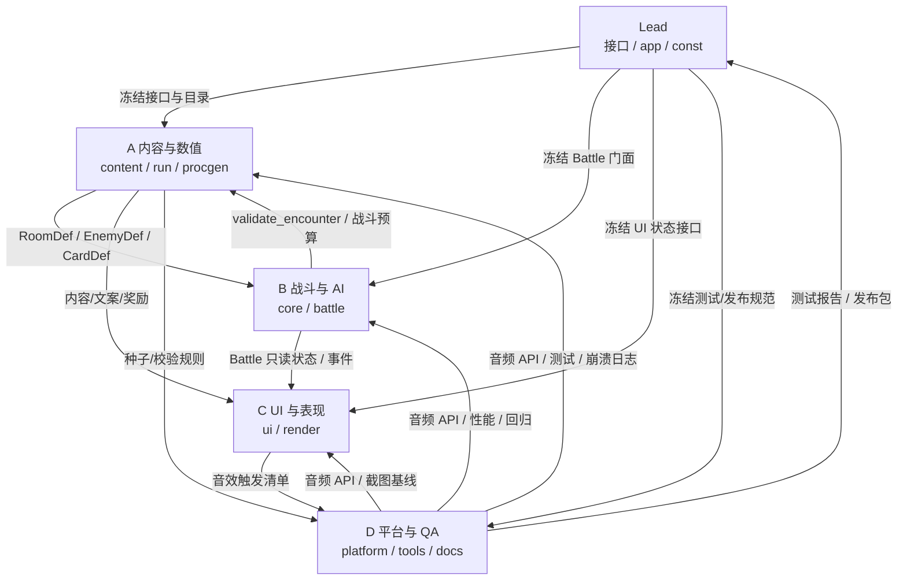

# 《内存远征》四人协作与分工手册

> 版本：2026-11-16
> 范围：**只做单人模式，不做联机**
> 基线：当前可玩的 5 区 18 战 + 5 Boss + 4 教程
> 原则：**不重写玩法，先按文件所有权并行开发**
> 相关文件：
> - 当前目录结构：`STRUCTURE.md`
> - 当前内容清单：`CONTENT_CATALOG.md`
> - 启动：`python run.py --windowed`
> - 一键回归：`python tools/run_all.py`
> - 新功能沟通：`../FEATURE_REQUEST_GUIDE.md`

---

## 0. 先说结论

### 0.1 不重写

现有版本已经包含：

- 引用图 / refcount / GC 级联
- 16 张卡牌、14 个模块、6 条 Boss 规则
- 12 种普通敌人、3 种 Boss
- 22 个房间：4 教程 + 18 正式
- 商店、整备、卖卡、免费 ++、碎片经济
- 画质四档、坏死格、低画质像素化
- 程序化音频、AI 娘、几何怪物
- 一套无头回归测试

这些是内容和调优资产。当前问题不是“玩法设计错了”，而是“代码要让人能并行改”。所以做重构、拆文件、定接口，不做重写。

### 0.2 四个人怎么分

| 角色 | 一句话 | 主目录 |
|---|---|---|
| **A 内容与数值** | 游戏里有什么、难度多少、奖励多少 | `content/`、`run/` |
| **B 战斗与 AI** | 规则怎么跑、敌人/Boss 怎么动 | `core/`、`battle/` |
| **C UI 与表现** | 玩家看到什么、怎么操作 | `ui/` |
| **D 平台与 QA** | 能不能稳定跑、能不能测、能不能发 | `platform/`、`tools/` |
| **Lead** | 接口、状态机、合并、验收 | `app.py`、`const.py`、根入口 |

### 0.3 程序化世界生成给谁

**给 A，不单独开第五个人。**

- A 拥有 `content/`，世界生成本质是内容系统。
- B 提供 `validate_encounter()`，判断生成出来的遭遇是否可打。
- D 提供种子批量回归工具。
- Lead 冻结 `RunPlan` / `RoomPlan` 接口。
- C 只负责把生成结果画出来，不决定生成规则。

如果以后世界生成膨胀成独立系统，再从 A 拆出第 5 个 “Worldgen” 角色；当前四人阶段不建议。

---

## 1. 当前代码地图

```text
RE-AI/
├─ run.py                      启动
├─ README.md
├─ docs/
│  ├─ STRUCTURE.md             当前目录/所有权
│  ├─ TEAM_PLAN.md             本文件
│  └─ CONTENT_CATALOG.md       当前内容清单
├─ tools/
│  ├─ architecture_test.py     分层依赖检查
│  ├─ mechanics_test.py
│  ├─ rooms_test.py
│  ├─ flow_test.py
│  ├─ tutorial_test.py
│  ├─ screens_test.py
│  ├─ drag_test.py
│  ├─ audio_test.py
│  └─ run_all.py
└─ memory_run/
   ├─ const.py                 Lead 所有
   ├─ core/
   │  ├─ model.py              Node / Edge / Graph
   │  └─ cards.py              Card / Grid / Hand / Deck
   ├─ content/
   │  ├─ bodies.py
   │  ├─ avatars.py
   │  ├─ modules.py
   │  ├─ boss_rules.py
   │  ├─ card_defs.py
   │  ├─ rooms.py
   │  ├─ pools.py
   │  └─ progression.py
   ├─ run/
   │  └─ runstate.py           远征状态 / 商店 / 卖卡
   ├─ battle/
   │  ├─ battle.py             门面
   │  ├─ core.py               Battle 本体
   │  ├─ input.py              选卡 / 拖拽 / 划线
   │  ├─ actions.py            卡牌动作
   │  ├─ gc.py                 伤害 / 死亡 / GC
   │  ├─ player.py             玩家 / 画质 / 受击
   │  ├─ enemies.py            敌人 / Boss / 增援
   │  ├─ entities.py           Projectile / AliasPool
   │  ├─ constants.py          HP / 颜色 / 玩家半径
   │  └─ deps.py               战斗公共依赖
   ├─ ui/
   │  ├─ app.py                状态机 / 输入 / 主循环
   │  ├─ render.py             渲染门面
   │  ├─ render_common.py
   │  ├─ render_core.py
   │  ├─ render_world.py
   │  ├─ render_hud.py
   │  ├─ render_hand.py
   │  ├─ screens.py
   │  ├─ deckui.py
   │  └─ fx.py
   └─ platform/
      └─ audio.py
```

兼容 shim：

```text
memory_run/app.py      -> ui.app
memory_run/battle.py   -> battle.battle
memory_run/cards.py    -> core.cards
memory_run/model.py    -> core.model
memory_run/runstate.py -> run.runstate
memory_run/render.py   -> ui.render
memory_run/screens.py  -> ui.screens
memory_run/deckui.py   -> ui.deckui
memory_run/fx.py       -> ui.fx
memory_run/audio.py    -> platform.audio
```

新代码优先使用新路径；旧 shim 只用于兼容现有测试和旧脚本。

---

## 2. 总分工

### 2.1 文件所有权

| 路径 | Owner | 说明 |
|---|---|---|
| `run.py` | Lead | 入口 |
| `memory_run/const.py` | Lead | 布局/颜色/字体，冻结 |
| `memory_run/ui/app.py` | Lead | 状态机、输入分发 |
| `memory_run/core/model.py` | B | 引用图 |
| `memory_run/core/cards.py` | B | 卡牌/网格逻辑 |
| `memory_run/content/*` | A | 全部内容数据 |
| `memory_run/run/runstate.py` | A | 远征/经济/推进 |
| `memory_run/battle/*` | B | 战斗规则 |
| `memory_run/ui/render*.py` | C | 表现 |
| `memory_run/ui/screens.py` | C | 界面 |
| `memory_run/ui/deckui.py` | C | 整备/商店 |
| `memory_run/ui/fx.py` | C | FX |
| `memory_run/platform/audio.py` | D | 音频 |
| `tools/*` | D | 测试/工具 |
| `*.md` | D 汇总，Owner 提供内容 | 文档 |

### 2.2 不碰清单

每个人默认不改别人的目录。必须改时：

1. 先写 issue / PR 描述。
2. 找 Owner 确认。
3. 由 Owner 改，或 Owner 明确授权。
4. Lead 合并。

禁止：

- 两个人同时改 `ui/app.py`
- UI 直接改 `node.hp` / `edge.kind`
- 内容模块里写战斗 `if room.code == ...`
- 战斗模块 import UI
- 直接 force push `main`

---

## 3. 依赖关系

### 3.1 总图



### 3.2 硬依赖

没有它就无法开始或验收：

| 被依赖 | 依赖谁 | 交付 |
|---|---|---|
| 所有人 | Lead | 接口冻结、目录骨架 |
| A 的世界生成 | B | `validate_encounter()` / 战斗预算 |
| B 的战斗解耦 | A | `RoomDef` / `EnemyDef` / `CardDef` |
| C 的 HUD | B | `Battle` 只读字段 / 事件名 |
| B/C 的音效 | D | `audio.play()` / 注册表 |
| A 的平衡 | D | `balance_sim` / 种子 CSV |
| 所有人的合并 | D | `run_all.py` / 回归 |

### 3.3 软依赖

可以先用占位：

- C 的最终视觉 → 先用线框/占位色
- D 的最终音色 → 先用 `audio.play("ui")`
- A 的最终文案 → 先用 `TODO`
- A 的程序化生成 → 先用手写 18 关

### 3.4 RACI

R=执行，A=批准，C=咨询，I=知会。

| 事项 | Lead | A | B | C | D |
|---|---|---|---|---|---|
| 公共接口 / const | **A/R** | C | C | C | C |
| 内容/房间/卡牌 | A | **R** | C | I | I |
| 数值平衡 | A | **R** | C | I | C |
| 程序化世界生成 | A | **R** | C | I | C |
| 战斗规则/GC/Boss | A | C | **R** | I | I |
| 可打性校验 | A | C | **R** | I | C |
| UI/渲染/整备 | A | C | C | **R** | I |
| 音频/平台/崩溃 | A | I | I | C | **R** |
| 测试/CI/发布 | A | C | C | C | **R** |
| app 状态机 | **A/R** | I | C | C | I |
| 合并/版本 | **A/R** | I | I | I | C |

### 3.5 关键路径

```text
Lead 冻结接口
  → B 保持 Battle 门面稳定
    → A 继续加内容
      → C 接只读状态做表现
        → D 全量回归
          → A 接程序化生成
            → 全组内容扩充
```

真正的三个阻塞点：

1. **Lead 的接口冻结**
2. **B 的 Battle 门面**
3. **D 的一键回归**

---

## 4. 接口契约

### 4.1 Battle 只读状态

UI 可以读：

```python
battle.graph
battle.player_node
battle.projectiles
battle.time
battle.state
battle.quality
battle.quality_band()
battle.deck
```

UI 不可以：

- 直接改 `node.hp`
- 直接删 `graph.nodes`
- 直接改 `edge.kind`
- 在 `draw()` 里推进游戏状态

### 4.2 Battle 命令

```python
battle.update(dt, input_state)
battle.on_mouse_down(pos, button, mods)
battle.on_mouse_move(pos)
battle.on_mouse_up(pos, button, mods)
battle.select_slot(i)
battle.select_reserve(i)
battle.select_overflow(i)
battle.drop_card_at(pos)
battle.use_card(card, where, target=None)
```

所有修改从这些入口进。

### 4.3 内容 schema

房间：

```python
RoomDef(
    code="R10",
    title="FRAGMENT TIDE",
    cn="碎片潮",
    zone=4,
    danger=8,
    nodes=[...],
    edges=[...],
    boss=False,
    intro="...",
    hint="...",
)
```

节点：

```python
NodeDef(id="ward", kind="WARD", pos=(0.3, 0.4), hp=50,
        data={"barrier": True})
```

边：

```python
EdgeDef(src="scope", dst="ward", kind=STRONG)
```

卡牌：

```python
CardDef(key="CUT", cn="单剪", shape=(1, 2), target="edge",
        work=1, rarity=0, desc="...", up="...")
```

### 4.4 RunState

```python
run.shards
run.hp
run.deck
run.room
run.zone
run.zone_name
run.make_card_rewards(...)
run.make_shop_items(...)
run.buy_shop_item(item)
run.sell_card(card)
run.repair_dead(n, cost_per)
run.advance()
```

### 4.5 FX / Audio

```python
fx.add_flash(amount, color, decay)
fx.add_shake(mag, decay)
fx.add_parts(x, y, color, ...)
fx.add_ring(x, y, r0, r1, color, ...)
fx.add_text(x, y, text, color, ...)

audio.play(name, vol=1.0, gap=0.045)
audio.toggle_mute()
audio.next_device()
```

音效名必须先在 `platform/audio.py` 的 `_build()` 注册。

### 4.6 世界生成

```python
generate_run(seed, difficulty) -> RunPlan
```

`RunPlan` 只含数据，不含 pygame 对象；生成不发生在战斗循环里。

---

## 5. A：内容与数值

### 5.1 使命

让游戏“有东西可玩、难度合理、奖励有吸引力”。

你负责内容数据和数值参数，不负责战斗代码本身。

### 5.2 你的文件

可以改：

```text
memory_run/content/*
memory_run/run/runstate.py
docs/balance_report.md
docs/content_catalog.md（或根目录 CONTENT_CATALOG.md）
```

可以读：

```text
memory_run/core/*
memory_run/battle/*
memory_run/ui/*
memory_run/platform/*
tools/*
```

不要改：

```text
ui/app.py
ui/render*.py
ui/screens.py
ui/deckui.py
battle/*
core/*
```

需要新战斗行为时，提给 B：

> 需求：新增 `BOMB` 的死亡爆炸范围
> 数据：`content/rooms.py` 里放 BOMB
> 需要 B：`gc.py` 的析构分支读取 `data["explode_radius"]`
> 验收：`mechanics_test.py` 加一条

### 5.3 内容模块对应

| 想加什么 | 改哪里 |
|---|---|
| 卡牌 | `content/card_defs.py` + `content/pools.py` |
| 房间 | `content/rooms.py` |
| 敌人编成 | `content/rooms.py` 的 nodes/edges |
| 敌人基础 HP | `battle/constants.py`（找 B） |
| 模块 | `content/modules.py` + B 的效果接入 |
| Boss 规则 | `content/boss_rules.py` + B/Lead 的效果接入 |
| 奖励池 | `content/pools.py` |
| 区域名 | `content/progression.py` |
| 身体 | `content/bodies.py` |
| AI 娘 | `content/avatars.py` |
| 经济/商店 | `run/runstate.py` |

### 5.4 新增房间流程

1. 写设计意图：
   - 这间房教什么？
   - 需要哪张卡？
   - 敌人怎么配合？
   - 失败时玩家学到什么？
2. 在 `rooms.py` 加 `RoomDef`。
3. 跑：

```powershell
python tools/rooms_test.py
python tools/architecture_test.py
```

4. 用 20 个种子模拟。
5. 看指标：
   - 时长
   - 掉血
   - 最低画质
   - 死亡率
6. 写 `docs/balance_report.md`。
7. 截图给 C 检查可读性。

### 5.5 新增卡牌流程

1. 定义：
   - target 类型：edge / two / node / area / self / dead
   - work
   - 稀有度
   - 基础/++ 效果
   - 解决什么考题
2. 改 `content/card_defs.py`。
3. 改 `content/pools.py` 加入奖励池。
4. 找 B 在 `battle/actions.py` 加 `apply_card` 分支。
5. 加 `mechanics_test.py`。
6. 更新 `CONTENT_CATALOG.md`。

### 5.6 新增敌人流程

1. 定义考题：高 HP / 多段 / 支援 / 反 CUT / 反 WEAK。
2. 在 `rooms.py` 放节点。
3. 如果现有行为够用，只调 HP/射速/数量。
4. 需要新行为才找 B 加 `enemies.py` 分支。
5. 跑长时模拟，确认不刷屏、不卡死。
6. 更新敌人表和 `CONTENT_CATALOG.md`。

### 5.7 平衡工作流

#### 定护栏

| 指标 | 目标 |
|---|---|
| 单局 | 35–50 分钟 |
| 普通房 | 45–120 秒 |
| Boss | 2–4 分钟 |
| 普通房掉血 | 5%–15% 最大 HP |
| Boss 掉血 | 20%–40% |
| 清房画质中位 | 40–75 |
| 连续低画质 | ≤2 房 |
| 通关率 | 新手 15–25%，熟练 40–60% |
| 碎片结余 | 平均 0–4 |

#### 循环

```text
跑基线 300 种子
→ 找异常房间
→ 一次只改 1–2 个变量
→ 同种子复跑
→ 看平均/中位/10% 最差
→ 真人试玩
→ 写 balance_report
```

#### 公式

```text
threat = effective_hp × dps × uptime
pressure = incoming_dps × expected_time / player_effective_hp
ttk = enemy_effective_hp / player_effective_dps
shard_flow = income - repairs - purchases
```

目标：

- 普通房 pressure 0.15–0.35
- 精英房 0.30–0.50
- Boss 0.50–0.80
- 普通怪 TTK 2–5 秒
- 精英 8–15 秒
- Boss 60–180 秒

### 5.8 程序化世界生成

Owner：A
Reviewer：B
接口/验收：Lead
批量回归：D

目录：

```text
content/procgen/
  seed.py
  templates.py
  room_graph.py
  encounter.py
  pacing.py
  validate.py
```

阶段：

1. 固定 18 关 + 种子选择商店/奖励
2. 手写模板 + 遭遇槽位随机
3. 房间图变体
4. 整局 `RunPlan`

硬约束：

- 可通关
- 至少一种解法
- 敌人预算不超
- 不连续 3 房无卡
- Boss 不在第一房
- 同种子同结果
- 生成 <100ms/局

### 5.9 A 的 P0/P1

P0：

- 修 `RoomDef.zone` 旧编号问题（见第 10 节）
- 18 关数值基线
- 卡牌/模块/商店经济
- 奖励池合法性
- 内容校验

P1：

- 程序化模板 + 槽位
- 敌人编队库
- 商店商品池
- 平衡 CSV 指标

P2：

- 房间图变体
- 种子回归
- 新卡/新模块
- 新区域

### 5.10 A 的验收

- 22 房全部可加载
- 18 正式关可通关
- 每关有明确考题
- 所有卡在奖励池
- 商店有可买项
- 碎片不溢出
- `run_all.py` 通过

---

## 6. B：战斗与 AI

### 6.1 使命

让引用图、卡牌效果、敌人和 Boss 稳定、可测、可配置。

### 6.2 你的文件

```text
core/model.py
core/cards.py
battle/*
```

不要改：

```text
content/rooms.py
content/card_defs.py
ui/*
run/runstate.py
```

### 6.3 战斗模块职责

| 文件 | 责任 |
|---|---|
| `battle/battle.py` | 门面，导出 Battle |
| `battle/core.py` | 初始化、建房、update、finalize |
| `battle/input.py` | 选卡、拖拽、划线 CUT |
| `battle/actions.py` | 卡牌动作、do_* |
| `battle/gc.py` | 伤害、死亡、GC |
| `battle/player.py` | 玩家、画质、别名、受击 |
| `battle/enemies.py` | 敌人、Boss、增援、投射物 |
| `battle/constants.py` | HP/颜色/PLAYER_R |
| `battle/entities.py` | Projectile / AliasPool |

### 6.4 卡牌动作管线

```text
use_card
  → 校验状态/腐蚀/费用
  → spend_work
  → apply_card
    → CUT / LINK / WEAK / ...
  → 成功：消耗手牌、补牌、FX、音效
  → 失败：退费、提示、不消耗
```

要求：

- 每个动作返回 bool
- 失败有明确原因
- 异常必须记录，不静默吞
- 不允许“扣了费没效果”

### 6.5 GC / 伤害

GC：

- 只数 STRONG 入边
- 玩家 HOLD 边不计
- 归零立即擦除
- 擦除递归处理出边
- 遍历时不要直接删列表
- 级联有上限

伤害顺序：

```text
无敌/免疫
→ 护盾/减伤
→ WEAK 增伤
→ 别名池
→ 扣 HP
→ 死亡/析构
→ FX/音效
```

### 6.6 敌人 / Boss

每个敌人：

- 初始化 timers
- 不依赖 UI
- 有攻击前摇
- 有射程/移动约束
- 有 WEAK/held/CAST 处理
- 死亡清理

Boss：

- 明确阶段
- 阶段提示
- 弱点/解法
- 不软锁
- 不无限召唤
- 死亡只结算一次

当前 Boss：

- `GC_CORE`：Pylon 未清时免疫，清后 10 向弹幕 + 召唤
- `AUDITOR`：烧坏死格
- `KERNEL`：三连扇形弹

### 6.7 给 A 的校验接口

```python
def validate_encounter(room_plan, starting_deck):
    return {
        "ok": True,
        "warnings": [],
        "estimated_time": 75.0,
        "estimated_hp_loss": 0.18,
        "required_cards": ["CUT", "WEAK"],
    }
```

### 6.8 B 的 P0/P1

P0：

- 保持 18 关/教程/机制测试通过
- 修 timers/GC/异常
- `validate_encounter`
- 不再引入 UI 依赖

P1：

- 敌人行为模块化
- Boss 阶段
- 增援/编队
- 事件名冻结

P2：

- 新卡效果
- 新敌人
- 战斗性能

### 6.9 B 的验收

- `mechanics_test` / `rooms_test` / `flow_test` 通过
- 长时模拟不崩
- 每个卡牌动作有测试
- `architecture_test` 通过
- UI 不需要读私有字段

---

## 7. C：UI 与表现

### 7.1 使命

让玩家“看得懂、点得动、感觉爽”，但不改变战斗规则。

### 7.2 你的文件

```text
ui/render.py
ui/render_common.py
ui/render_core.py
ui/render_world.py
ui/render_hud.py
ui/render_hand.py
ui/screens.py
ui/deckui.py
ui/fx.py
```

`ui/app.py` 与 Lead 共同维护，但状态机归 Lead。

### 7.3 UI 规则

- 只读 `battle` / `run` 状态
- 不直接改战斗对象
- 所有操作转成命令
- 不在 `draw()` 里改状态
- 不在 `draw()` 里加载文件

### 7.4 渲染分层

```text
render_common  → 卡面/文字/轨迹
render_core    → 初始化/draw/降质/拖拽残影
render_world   → 战场/引用线/敌人/玩家
render_hud     → HUD/网格/房间信息
render_hand    → 手牌/执行槽/横幅
```

### 7.5 输入与拖拽

```text
MOUSEDOWN 记录 card_press
MOUSEMOVE 超过 8px 判定 drag
MOUSEUP 松在目标 → 执行；外面 → 取消
单击 → 选中/使用
```

CUT：

```text
按住左键 → slash 路径
MOUSEMOVE → 追加路径
MOUSEUP → edges_on_path → 前 1/2 条
```

### 7.6 整备/商店/卖卡

- 拖卡进网格
- 拖回 BENCH
- 同名卡互拖免费 ++
- 拖到 SELL 卖碎片
- 商店买卡/模块
- 修格花碎片

操作后立刻刷新显示。

### 7.7 美术风格

- 深空蓝黑底
- 青色引用线 / 品红金色异常
- 几何怪物，不写实
- 三层粗引用线 + 单向流光
- 玩家 SELF 菱形 + 三旋弧
- 低画质是“渲染崩溃”，不是简单模糊
- 不引入外部图片

### 7.8 C 的 P0/P1

P0：

- 22 房 HUD 可读
- 整备/商店/卖卡可用
- CUT 划线反馈
- 截图基线

P1：

- 低画质分层
- 拖拽/悬停统一
- 教程高亮
- 商店/奖励视觉

P2：

- 新特效
- AI 娘表情
- 动画过渡

### 7.9 C 的验收

- 所有界面可操作
- 无文字溢出
- 无关键数字遮挡
- 拖拽/划线手感正常
- 低画质 HUD 清晰
- `screens_test` / `drag_test` 通过
- 不修改战斗状态

---

## 8. D：平台、音频与 QA

### 8.1 使命

让游戏能稳定跑、能测、能发布。

### 8.2 你的文件

```text
platform/audio.py
tools/*
README.md
STRUCTURE.md
TEAM_PLAN.md
CONTENT_CATALOG.md（汇总，内容 Owner 提供）
requirements.txt
开始游戏.bat
```

### 8.3 音频

API：

```python
audio.init()
audio.play(name, vol=1.0, gap=0.045)
audio.toggle_mute()
audio.is_muted()
audio.next_device()
audio.output_devices()
```

要求：

- 27 个音效全部注册
- F2 测试和弦
- F3 切设备
- 静音提示
- 缓冲回退
- 单/双声道兼容
- 节流
- 设备缺失不崩

新增音效流程：

1. 收需求：名字/触发/感觉/时长
2. `_build()` 注册
3. `audio_test.py`
4. 通知调用方

### 8.4 崩溃/平台

- `crash.log` 记录 traceback/时间/版本/房间
- `run.py` 参数：`--windowed` / `--headless` / `--shots`
- `.bat` UTF-8/工作目录/错误暂停
- 字体回退
- 全屏/窗口
- 打包

### 8.5 测试

已有：

```text
architecture_test
mechanics_test
rooms_test
flow_test
tutorial_test
screens_test
drag_test
audio_test
run_all
```

D 要继续补：

- `content_validate.py`
- `procgen_seeds.py`
- `soak_test.py`
- `perf_test.py`

### 8.6 D 的 P0/P1

P0：

- `run_all.py` 稳定
- 崩溃日志
- 音频注册完整
- 内容校验

P1：

- 种子回归
- soak/perf
- 截图基线
- CI

P2：

- 打包
- 发布文档
- 设备兼容

### 8.7 D 的验收

- 一条命令跑完全部测试
- 异常有日志
- 音频不崩
- 18 关自动跑通
- 发布包能启动
- 文档与代码一致

---

## 9. Lead：集成与接口

### 9.1 使命

让四个人不互相踩，让版本能合并、能验收。

### 9.2 你的文件

```text
run.py
memory_run/const.py
memory_run/ui/app.py
```

### 9.3 你的职责

- 冻结接口
- 维护目录骨架
- 合并顺序
- PR 评审
- 版本 tag
- 跨模块争议
- 最终验收

### 9.4 合并顺序

```text
1. 接口/核心
2. 内容数据
3. 战斗规则
4. UI
5. 音频/平台
6. 测试/文档
```

### 9.5 PR 评审

- 是否只改自己领地
- 是否改公共接口
- 是否有测试
- 是否影响 22 房
- 是否影响教程
- 是否影响截图
- 是否有回滚方案

### 9.6 出问题

1. 复现
2. 看 `crash.log`
3. 定位 Owner
4. 最小修复
5. 加回归
6. 合并
7. 更新文档

---

## 10. 当前已知问题与归属

这些问题写在 `CONTENT_CATALOG.md` 第 10 节，分配如下：

| 问题 | Owner | 优先级 | 说明 |
|---|---|---|---|
| `RoomDef.zone` 仍是旧 1–12 编号 | A | P0 | 会导致中段区域名/奖励池错位 |
| `discount` Boss 规则无效果 | A/B | P1 | 升级已免费，规则需重做或移除 |
| `perfect` 规则描述不符 | A/B | P1 | 描述“翻倍”，代码只 +1 碎片 |
| `ZOMBIE` 未实装 | A/B | P2 | 有 HP，无房间/行为 |
| ECC 描述提到“清除泄漏” | A/B | P2 | 当前只修坏死格 |
| 寄存器数据残留 | A | P2 | UI 已改 BENCH，不要继续依赖 |

A 的第一件事建议就是修 `zone`，否则后续平衡数据会按错误区域分组。

---

## 11. 协作流程

### 11.1 分支

```text
main
refactor/content
refactor/combat
refactor/ui
refactor/platform
feature/procgen
feature/content-zone6
```

### 11.2 提交前

```powershell
python -m py_compile memory_run\*.py
python tools\run_all.py
```

### 11.3 PR 模板

```text
## 改了什么
-

## 为什么
-

## 怎么测
- [ ] run_all
- [ ] 手动窗口

## 影响
- 接口：
- 内容 schema：
- UI：
- 存档/兼容：

## 截图
（UI/内容改动必须附）
```

### 11.4 禁止

- 直接改 `main`
- force push
- 跨领地大改
- 为了过测试删断言
- 把截图/构建产物/Crash log 提交进仓库
- 在 `draw()` 里推进游戏状态
- 在 `content/` 里写战斗分支

---

## 12. 验收标准

### 功能

- 22 房可加载
- 18 正式关可通关
- 4 教程可完成
- 商店/整备/卖卡/++/修格/碎片可用
- 16 张卡都能实际使用
- 14 个模块都有落点
- 5 个 Boss 房可通

### 工程

- `run_all.py` 全绿
- `architecture_test` 全绿
- 真实窗口启动通过
- 无新增 `crash.log`
- 新内容有测试或明确手动验证
- 文档与代码一致

---

## 13. 速查卡

### 每天开始

```text
我今天改哪个文件？
我依赖谁？
谁依赖我？
我今天能交付什么？
```

### 被阻塞

```text
1. 写清楚缺什么
2. 找对应 Owner
3. 找 Lead 决定是否绕行
4. 不自己改别人文件
```

### 提交前

```text
py_compile
run_all
PR 模板
截图（UI/内容）
```

### 交接

```text
- 改了什么
- 怎么测
- 还剩什么
- 下一步是谁
```

---

## 14. 一句话

> A 管内容，B 管规则，C 管表现，D 管可测/可发布，Lead 管接口与合并；先按目录所有权并行，不要把四个人的改动塞进同一个大文件。
